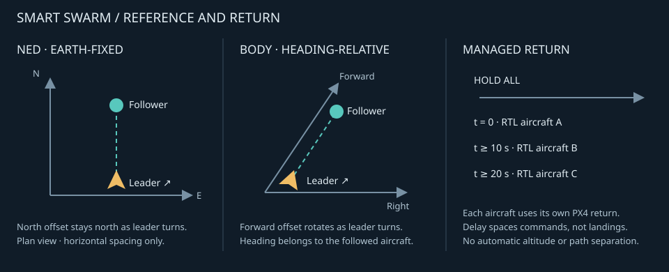
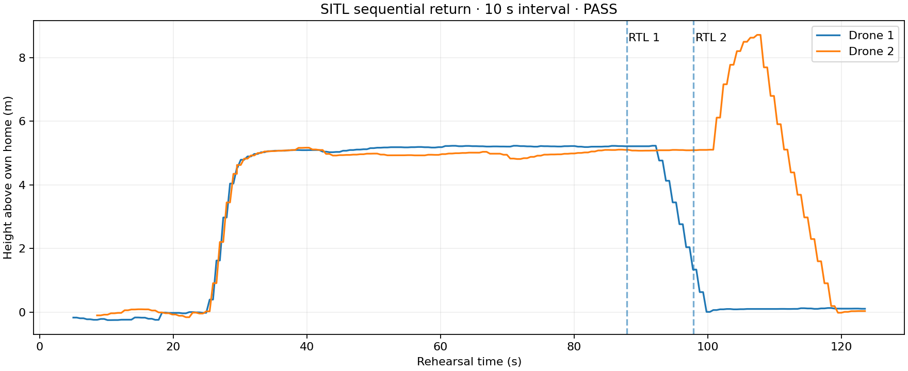

# Smart Swarm Guide

**Mission Type:** `2` (`SMART_SWARM`)  
**Primary UI Surface:** `Smart Swarm` (`/swarm-design`), with `Operate` / `Design Swarm` tabs
**Runtime Model:** live leader-follower formation with saved follow chains and in-flight reassignment

## Overview

Design and Operate expose a compact graphical **Formation** strip: **Plan formation**
opens the editable saved layout or existing draft; **Capture positions** previews
settled aircraft spacing. These setup workflows share one draft and never silently
reset it. **Revert** is a separate history action. Neither workflow selects a live
flight mode, pulls a repository, applies changes or launches aircraft. Apply and Start remain explicit.
Optional browser recovery lives under **Unsaved draft**, not a blocking banner.

Smart Swarm is the live, cooperative formation mode in MDS. Each drone uses a saved swarm assignment file:

- real hardware: `swarm.json`
- SITL: `swarm_sitl.json`

- `hw_id` identifies the physical drone
- `follow` identifies the drone it should follow by **hardware ID**
- `offset_x`, `offset_y`, `offset_z` define the relative formation offset
- `frame` controls whether offsets are interpreted in `ned` or `body`

Unlike the time-synchronized **Swarm Trajectory** mode, Smart Swarm is designed for live clustered operations where operators may change leaders, offsets, frames, or relay roles while drones are airborne.

Identity rule:

- Mission Config slot reassignment changes show-slot ownership only
- Smart Swarm follow chains stay `hw_id`-anchored
- true spare replacement belongs in Fleet Enrollment, which is where follow references are rewritten for the new hardware identity

The current Smart Swarm inner loop is a hybrid model:

- leader telemetry arrives as global `lat/lon/alt`
- when available, leader local `LOCAL_POSITION_NED` also rides along the dedicated swarm-state stream
- the follower runtime converts that into a shared local NED frame
- offsets are applied in either `ned` or leader-`body` coordinates
- PX4 receives local offboard `VelocityNedYaw` setpoints

That is intentional. Smart Swarm is a relative-control problem, so local offboard control is the primary path; global telemetry is only the outer reference.

## First SITL Run

For a clean first Smart Swarm demo in SITL:

1. launch the fleet:
   ```bash
   bash multiple_sitl/create_dockers.sh 5
   ```
2. start the dashboard:
   ```bash
   bash app/linux_dashboard_start.sh --sitl
   ```
3. open `Overview` to inspect aircraft identity, live telemetry and any conditions needing attention
4. open `Smart Swarm` → `Design Swarm` and verify the saved SITL assignments from `swarm_sitl.json`
5. use Top, Side, 3D and Links views to preview the intended cluster
6. open `Operate`, select the saved cluster and review its aircraft; use **Takeoff** if needed, then wait for the aircraft to be airborne and settled
7. choose **Start Swarm**, review the exact formation scope and native readiness, then confirm; **Managed Return** uses the same **To** selection when needed
8. if you want the full branch acceptance run from the command line, use:
   ```bash
   python3 tools/validate_smart_swarm_runtime.py
   ```
9. if you plan to chain Drone Show or Swarm Trajectory validation immediately afterward on the same SITL fleet, recreate the containers or manually restage the aircraft onto the next mode's launch geometry before the next run

The shipped 5-drone SITL demo layout currently contains two clusters and mixed `ned` / `body` offsets, so formation settle time is not instantaneous after takeoff.

Validator note:

- the Smart Swarm validator restores the selected saved swarm assignments after a successful reassignment drill, so a temporary runtime reassignment does not become the new saved SITL baseline
- it does **not** magically put landed aircraft back onto Drone Show staging slots; cross-mode launch validation still needs a deliberate launch-geometry reset between mission families

## Operator Model

Operator controls say **Geographic** for `ned` and **Leader-relative** for `body`.
The stored/API values and coordinate math are unchanged. NED and Body remain the
technical terms in help, logs and configuration documentation.

For illustrated field steps, including capture, takeoff, following, Hold and
return, use the [Smart Swarm operator workflow](../guides/smart-swarm-field-workflow.md).



The diagram is conceptual, not live telemetry. NED horizontal spacing stays
earth-fixed; Body spacing follows the parent's heading. Managed Return staggers
native RTL submissions; it does not separate return paths. Changing leaders is
not a continuous motion handover: review roles while stopped for the normal
operator workflow. Continuous moving handover remains outside the accepted scope.

### Design Swarm workflow

The **Design Swarm** tab is one linked formation workspace. Top, Front, Side, 3D,
Links, the aircraft list, and the inspector all use the same draft.
Links shows the leader/follower relationship, not geographic spacing. Body-frame
geometry uses an explicit design-preview heading; live telemetry never moves a
draft underneath the operator. Independent clusters are shown separately and
do not imply saved spacing between their leaders.

**Capture positions** opens the only cluster automatically, or preserves the selected cluster
when several exist. Its read-only preview opens in interactive orthographic 3D,
with Top/Front/Side switches, multirotor silhouettes and a leader star. It uses
the shared formation-coordinate model; its small vector renderer does not need
WebGL. Mouse/touch orbit, pan and zoom only change the camera. Solid positions
are the frozen capture and ghost positions are live
estimates from the existing GCS fleet cache. Viewing adds no aircraft RPC polling;
native two-sample validation remains exclusive to explicit capture/Refresh.
Delayed or nonadvancing samples are marked, including during successful but
frozen HTTP responses. Live data cannot edit an assignment or satisfy capture
authority. Changing cluster cancels/ignores the old capture request.

Height defaults come from both native capture epochs: a whole grounded cluster
selects Same height; a fully airborne settled cluster with valid Current capability
selects Current. Mixed/inconsistent evidence or unstable airborne height recommends
nothing; the operator must explicitly choose an available option. Explicit choices
survive Refresh; otherwise a new capture updates the recommendation. Same height
zeroes relative heights; Current copies estimated common-MSL differences. This
does not calibrate independent altitude estimates. Leader/reference settings are
collapsed under Adjust formation and never implicitly changed.
Current's availability and reason come from the backend's frozen observations,
not separate UI thresholds. A captured draft still requires inactive, revision-aware
Apply; other clusters and existing in-flight edit behavior remain unchanged.

The normal operator path is:

1. select an aircraft in the plan;
2. set `Follows` and spacing;
3. select **Apply plan** to use it on this GCS, or **Save to repo** to apply
   and then commit/push the acknowledged revision;
4. use **Operate** for flight commands.

Edits are kept in a browser-local draft until explicitly applied. **Apply plan**
writes the validated formation to the GCS; running Smart Swarm nodes may observe
that revision through the configuration watch with HTTP reconciliation. **Save to repo** applies
a changed draft first, then commits/pushes that exact revision when repository
write access is available. An already-applied plan is published without reapplying.
Repository failure does not undo a successful Apply; retry saves to the repo only.
These outcomes are separate from aircraft synchronization; the page reports
each outcome independently. Import and export remain under the Files menu.
The separate **Revert** icon restores the last loaded/applied GCS plan locally after confirmation
and is undoable; **Undo** reverses the last complete edit or drag.

**Four views** is the default and shows Top, Front, Side and 3D together; a panel
can be expanded. Fit, Focus and zoom are linked across all four panels by default;
toggle **Linked views** off when independent camera control is needed.
All views use the selected aircraft's reference: North/East for NED, or the
followed aircraft's Forward/Right axes at its explicit preview heading for Body.
Top changes both horizontal axes; Front changes East/Right and Up; Side changes
North/Forward and Up. Viewing orientation never changes saved offsets.
The 3D move tool starts with **All directions**, so a selected follower has
horizontal and Up handles. **Move** also offers optional horizontal and vertical
plane restrictions. Height edits update **Above** in the same undoable draft;
no flight command is sent. Roots are fixed local
origins, not geographic destinations. A changed relay moves its dependent branch;
children retain their relative offsets. Frame changes and reparenting within one
cluster preserve preview positions. Joining independent clusters requires a separate
confirmation because there is no shared origin to preserve. Preview headings do
not command yaw. Undo/Redo acts on whole drag gestures; Escape cancels a drag.
Unfocused fields show readable precision, retaining the full draft value on
focus and in saved data. Callsign/alias is used where available; unnamed aircraft
use hardware ID. Duplicate names include hardware ID; roster/inspector show current
hardware and position IDs, and **Show IDs** adds them to plot labels.

### Operate display

**Telemetry delayed** means the current aircraft sample is unavailable or the
preview fetch failed, not proof the aircraft is powered off. Cached formation
membership remains visible, but stale telemetry cannot claim current airborne,
grounded or preflight status. A separate stale controller report is
**Unconfirmed**; a fresh controller failure still appears as **Failed**.
Replacing a running swarm with Hold or another command normally ends the old
operation as **superseded**, not a successful completed flight and not an
unexpected controller failure. The old operation's replacement notice is
informational; separately verify the new Hold/Return result on every aircraft.

Operate is read-only except for explicit flight controls. Its diagram shows live
roles and flight/following status, not geographic spacing or editable offsets.
Secondary actions and links are behind the header overflow control. Hold remains
an immediate cluster-wide recovery action; its neutral button is not an alert.
Active return queues keep progress and Cancel remaining visible. Historical
terminal queues are not persistent banners; a newly dispatched summary expires
after 10 seconds while aircraft Returning/Landing/Grounded status remains driven
by fresh telemetry. Unconfirmed work remains visible; dismissing a failure notice
does not cancel a command. Full command history remains in the existing activity/log surfaces.

**Apply during flight:** editing alone sends nothing. Applying changes the GCS
configuration that running swarm processes watch and reconcile. If affected aircraft are
unreachable, **Apply anyway** explicitly accepts that reachable aircraft may
change first and others may adopt the plan on reconnect. This is not simultaneous
dispatch or collision avoidance. The readback strip separates **Applied** (effective
controller configuration), **Pending**, **Unreachable**, and **Next start** (no active
swarm). Applied does not mean the aircraft has arrived at its new formation position.
Hold, pilot takeover and Managed Return are never implicitly resumed by editing.
An unresolved active update must be resolved or the swarm stopped before another
update. Revision conflicts preserve the local draft for review rather than overwriting
a newer GCS plan.

### Managed Return

**Managed Return** is the operator-facing sequential RTL action. It first
requests Hold, then sends native PX4 RTL commands in the displayed order at the
configured interval (10 seconds by default). The interval is between command
issuance, not between landings. Return paths may overlap and each aircraft uses
its configured PX4 return height and home position; the dialog does not invent
or override those values. Globe remains the geographic view; the Swarm page
uses a compact relationship/status diagram instead.

Takeoff, Start Swarm and Managed Return share the exact **To** choice. Accepted
reduced Takeoff targets carry forward; cancelled edits do not. Choices survive
navigation in the same browser session/operator/runtime/cluster. A new cluster
defaults to its full roster; reconnects never add targets. **Hold all** is the
explicit whole-cluster exception. Before returning a source, MDS checks for
omitted tracked pending/active followers; include them or stop them explicitly.
This check repeats before each RTL and does not replace flight-path separation.



Measured SITL example: the dashed lines mark RTL submissions, not landing
clearance. Height is relative to each aircraft's own home. This run illustrates
the queue; it does not prove separation for other homes, heights or return paths.

### Hold Swarm

**Hold all** sends Hold to the entire displayed cluster, including its leader,
in one press. It remains available while routine commands are waiting; no
confirmation dialog or remembered Swarm session is required. Roles and offsets
are preserved. Held aircraft do not resume following when the leader moves:
review and confirm **Start Swarm** to rejoin.

An accepted request is not a confirmed stop. Each aircraft reports **Held**,
**Disarmed** (or **Grounded** when PX4 confirms landed state), or **Hold
unconfirmed**. Disarmed Hold is a no-op: it does not arm or launch. A new recovery
request fences older pending Takeoff/Start work and invalidates unused launch
preparations, so a delayed reply cannot silently restart that work. This is a
networked flight-mode request, not a replacement for the pilot's RC takeover.

### Design persistence workflow

Use the **Apply plan** and **Save to repo** controls described above. A failed
repository publication does not undo a successful GCS Apply; retry publication
without reapplying. Progress distinguishes the GCS save, commit and remote push.

Offset fields accept signed meter values. On mobile, use the normal text
keyboard if the numeric keyboard does not expose a minus key.

Smart Swarm now has two clean command scopes:

### 1. Single-drone commands

Use Overview's general aircraft actions when you want to affect only one
aircraft. New mission starts belong on that mission's dedicated page with its
own reviewed targets, not on Overview.

Examples:

- send `RTL` to one drone
- send `LAND` to one drone
- select one aircraft in the relevant mission workspace when that mission supports a single-aircraft scope

These commands stay scoped to that drone. They do **not** automatically cancel Smart Swarm on unrelated drones.

Important caveat:

- if the addressed drone is a leader or relay leader, its followers may still react through normal leader-loss logic
- that can mean continued following, upstream reassignment, or self-hold, depending on topology and live health
- so command scope stays local, but topology side effects can still propagate through the follow chain

### 2. Normal Smart Swarm start

Open **Smart Swarm → Operate**, select the saved cluster and review its
leader/offset/status summary. Use **Takeoff** there, or take off through
QGroundControl or RC, and let the aircraft stabilize. Choose **Start Swarm** and
confirm the reviewed aircraft. Opening the page or changing inspection never
sends a command. **To** initially contains the complete saved cluster. Open it
only to deliberately command a subset. Required unselected upstream aircraft
become read-only leader references, not additional command recipients; saved
follow links are never rewritten. The takeoff does not have to come from MDS. Overview
retains fleet awareness and general aircraft actions, not a second swarm launcher.

The Start review reads each selected aircraft's own admission decision. A
single status shows `Checking aircraft`, `Finishing takeoff`, a named blocker,
or `Ready`. Confirmation enables when every reviewed target is eligible;
it never automatically sends Start when readiness changes. Optional LED
indication does not delay Take Off completion. Manual/QGC takeoff remains
supported without requiring an earlier MDS Take Off command.

Confirmation repeats the node review before dispatch; node acceptance and the
existing required-role barrier still handle a state change after that review.
This is not a distributed reservation or atomic flight guarantee. A delayed
completion callback does not override fresh node action state. Missing or
stale evidence is not Ready. If a submission response is lost, `Check command`
performs read-only receipt lookup, never a command submission. An absent
receipt requires fresh review and explicit confirmation, retaining the same
Start identity. The browser retains an unresolved Start in session
storage so refresh can recover that same command. Stop/Hold, Land, RTL and
pilot takeover do not wait for this review machinery. A busy Start dialog can
be closed to reach recovery controls; closing the display does not cancel an
already-confirmed command. Pending intent is scoped to that backend/runtime.

MDS still performs authoritative node-side airborne, PX4, link, and
configuration checks. These are not UI bypasses. Dashboard telemetry age is
advisory, not a second start gate. Start normally includes every displayed saved
role, independently of Overview's generic selection checkboxes. **To** also
supports an explicit healthy subset or follower retry. References need current
native airborne evidence, compatible software and matching live follow links;
they are checked before dispatch and again before the required-role barrier
releases. They receive no Start and introduce no ongoing GCS flight dependency.
An unavailable/returning source blocks Start rather than orphaning its followers.
Full-cluster starts retain the existing older-companion wire contract.

Recipient edits affect future Takeoff/Start/Managed Return/individual recovery.
They do not stop an existing follower. **Hold all** explicitly retains full
displayed-cluster recovery. The
runtime preview reports latest ownership per aircraft, not just the newest
cluster command, so an old leader cannot mask a new follower retry.

### 3. Advanced Swarm runtime commands

Use **Smart Swarm → Operate** for live Smart Swarm control:

- **Start Swarm** for the reviewed saved cluster
- **Hold all** for the displayed cluster
- **Managed Return** for sequential RTL to **To**
- **Other actions → Stop following / Land here / Immediate RTL** for explicit recovery

The Operate cluster selection is independent of formation inspection and
Overview's general aircraft selection. **To** selects the aircraft for Takeoff,
Start, Managed Return and Other actions; inspect the exact target list before
confirming. Hold all retains the entire displayed cluster. An ambiguous or non-executable
cluster blocks cluster commands instead of silently choosing another cluster.
Runtime preview and targets use the saved assignment; unsaved formation edits
do not silently change a recovery target set.

**Hold all** ends following across the cluster; **Other actions → Stop following**
ends following only for To. Both command PX4 Hold on the addressed
airborne drone; resuming requires an explicit Start. **Land here** commands each
selected drone to land at its current position. **Immediate RTL** ends following and
commands each selected drone's own PX4 Return mode. It is **not** a coordinated
formation return: PX4 may climb, choose different paths/destinations, or reject
Return if its position/home requirements are unmet. MDS recovery commands
require a working data link and per-aircraft acceptance, so monitor the tracked
result for every target and keep the RC takeover path available. Review each
aircraft's RTL configuration and landing separation before flight.

This keeps swarm intent explicit instead of overloading the generic command sender with swarm-only controls, and it preserves mixed-mission operations when only part of the fleet is flying Smart Swarm.

### Sequential Return

On **Smart Swarm → Operate**, check **To** and choose **Managed Return** for
those aircraft.
Review the **Return interval** (default **10 seconds**, range 1–300 seconds).
The confirmation lists the exact aircraft order and relative dispatch times.
MDS ends following and confirms Hold on all selected aircraft, then dispatches
each aircraft's normal PX4 RTL in that order. The interval is a minimum between
RTL submissions; delayed confirmation can extend it. It does **not** wait for
each landing. Return paths can overlap: this mode spaces commands and does not
plan collision-free trajectories or assign altitude layers. Each aircraft keeps
its own PX4 return altitude, home/rally destination, descent and failsafes.

The GCS owns the queue, so navigating away or refreshing the browser does not
stop it. The panel recovers its status after refresh. **Cancel remaining** stops
pending commands; an already-issued Hold or RTL continues. A newer MDS flight
command affecting a participating aircraft cancels the pending queue. Before
each RTL, fresh telemetry must still show that waiting aircraft armed in Hold;
pilot takeover, disarming or missing telemetry stops the remaining queue.
Command rejection or unconfirmed execution also stops it, with the reason shown.
Use the existing command monitor for each individual Hold/RTL result.

A GCS shutdown/restart interrupts the remaining queue and never silently
resumes it. Aircraft already in RTL continue under PX4; aircraft still waiting
remain under PX4 Hold/failsafe control. The final status **RTL commands started**
does not claim that the aircraft have landed. Plan battery reserve for the
waiting interval as well as each return flight. This initial version adds no
formation, leader-election, PX4 parameter or estimator changes.

The dedicated Operate page owns the tracked swarm session contract, cluster
selection and recovery controls; it does not use a generic mission scheduling
form. Start requires a complete saved follow chain. Individual recovery remains
an explicit **Other actions** choice, not a change to Start's cluster scope.

Overview's general **Return** means immediate native PX4 RTL for its selected
aircraft. It is not Managed Return and does not create a sequential return queue.
See the [Dashboard Operator Guide](../guides/dashboard-operator.md) for general actions.

These runtime commands publish into the same shared command activity as
Overview's general aircraft actions. The backend-backed live/recent monitor
recovers command context after refresh/navigation; runtime actions are not
toast-only events.

Mixed-mission leader rule:

- a Smart Swarm leader can be selected alone and reassigned into Standard Drone
  Show or Custom CSV Drone Show without cancelling Smart Swarm on unrelated
  followers
- the addressed leader interrupts its own Smart Swarm runtime script before the
  new show mission starts; follower drones keep their current Smart Swarm
  mission and continue tracking the leader as long as usable leader telemetry is
  still published
- prefer `Stop Swarm (Hold)`, `Land Swarm`, or `RTL Swarm` when you want to
  recover a live formation; normal cancellation also performs a bounded
  Offboard-to-HOLD handoff before its controller exits, but the dedicated
  recovery controls communicate the operator's intent more clearly
- if the leader changes, update the saved/runtime follow chain deliberately in
  Swarm Design instead of relying on implicit mission side effects

### Formation preview and live readiness

The dedicated **Smart Swarm → Operate** tab owns the saved-cluster control panel:
**Takeoff → Start Swarm → Managed Return** are separate confirmed actions, never a combined
automatic mission. The first saved cluster is the initial default. The runtime
selection is retained for this GCS/mode browser session and is independent of
drone inspection, formation plots and general dashboard dispatch selection.
If the selected cluster disappears, select again; MDS never substitutes another.
The **Design Swarm** tab holds editing, graphs, imports, exports and publishing.

Managed Return defaults to **Sequential RTL · 10 s** with the order and interval in its
confirmation. This is timed dispatch, not collision avoidance or waiting for
each aircraft to land. Paths may overlap. Immediate RTL, Land here and explicit
individual-aircraft recovery are in **Other actions**. **Stop following** commands
Hold and requires an explicit start to resume. Aircraft already in RTL continue
when **Cancel remaining** cancels pending work.

The preview is advisory, not proof of PX4 acceptance. Armed does not mean
airborne; missing/stale evidence is unknown. Confirmations bind the saved
formation revision and targets. Full starts use the cluster-start API;
partial starts are an explicit advanced exception using current unavailable
dependency exclusions. Supplied session snapshots cannot bypass cluster scope.

The `Smart Swarm Runtime` panel intentionally separates:

- saved formation preview
- live readiness snapshot

The preview shows the saved follow chain, roles, and offsets for the current runtime target. The live readiness snapshot is based on current telemetry/readiness state for the targeted drones.

Important operator rule:

- formation plots are not live flight views
- every targeted drone must have current telemetry and authoritative
  armed/airborne evidence; MSL altitude is never treated as height above launch
- runtime start performs the same final airborne admission again at command
  dispatch time
- Takeoff uses a coherent, fresh native disarmed/`ON_GROUND` observation plus
  PX4 launch readiness. Home-relative height is diagnostic, not ground clearance
  or an additional Takeoff gate. Swarm requires fresh armed/`IN_AIR` evidence,
  not an arbitrary home-relative height floor. PX4 still owns EKF, heading,
  navigation and arming checks. The props-off ground arm/disarm test retains
  its separate ±1.0 m home-height guard.
- if a target drone is not ready, fix that on `Overview` or `Mission Config` before start
- normal Smart Swarm starts are cluster-first: the page opens the first executable
  saved cluster and shows the full leader/follower roster before confirmation;
  a leader-only target is rejected before dispatch
- multi-aircraft standalone Takeoff defaults to **Launch mode → All armed first**:
  confirm native readiness, arm all, then release takeoff only after every
  selected aircraft confirms armed on ground. The shared dialog includes height,
  per-aircraft reasons and progress. See the
  [Coordinated Takeoff guide](../guides/coordinated-takeoff.md).
  Launch is not physically atomic after release: one aircraft can still reject
  while another accepts. Verify each aircraft is airborne and settled before
  starting the exact Smart Swarm cluster. PX4 checks are unchanged.

### Runtime ownership and leader changes

Each start carries a command/session ID and saved-topology revision. Both roles
acknowledge that session before the follower engages. Runtime status separates
configured role from active role and reports `Starting`, `Active`, `Partial`,
`Pilot takeover`, or `Stopped`. Missing runtime evidence is `Degraded` or
`Unconfirmed`, never proof that the aircraft stopped. If one required role
rejects startup, another role's process launch is not shown as a fully active
formation. A retry after a lost HTTP response recovers the same command ID.

The follower watches PX4 mode, armed state, and landed state. RC/QGC RTL, Land,
or manual takeover stops follower setpoints and preserves the selected recovery
mode; MDS never countercommands it with HOLD. This watcher does not elect
leaders. The default `hold_recover` policy retains the assigned leader: after
the existing hard-stale limit it requests PX4 Hold, waits up to 10 seconds for
one continuous second of fresh leader/own-state evidence and confirmed internal
Hold, then smoothly reacquires. If the window expires, following remains paused
even if data returns later. Use **Stop Swarm (Hold)**, then **Start Smart Swarm**
for the complete formation to retry. This does not arm or take off. Pilot mode
changes, RTL, landing and disarming cancel automatic recovery.

Automatic promotion is disabled by default. Advanced deployment settings in
`/etc/mds/local.env` are `MDS_SMART_SWARM_LEADER_LOSS_STRATEGY=hold_recover`,
`MDS_SMART_SWARM_LEADER_RECOVERY_WAIT_SEC=10`, and
`MDS_SMART_SWARM_LEADER_RECOVERY_STABLE_SEC=1`. These are not dashboard switches.

`MDS_SMART_SWARM_HARD_STALE_TIMEOUT_SEC=2.5` controls when stale leader data
initiates protective Hold. It is available in advanced node configuration and
must exceed the accepted-source freshness threshold. All timing changes require
a grounded node-service restart. Invalid/non-finite recovery timing or a stable
interval not shorter than the wait window logs a warning and restores 10s/1s
defaults at startup, rather than failing when protective recovery is needed.
Automatic promotion remains disabled by default; these settings do not change
saved roles or make an unvalidated moving handover available.
Change them only while grounded and restart the affected runtime. For deliberate
multi-level failover, set the strategy to `upstream_or_hold` consistently on GCS
and nodes; after the recovery window it follows a cycle-safe upstream leader,
or self-promotes and holds. Automatic recovery never saves a new formation.
User-edited leader changes use the same transition
path. Runtime assignment files carry session ownership and become inactive on
shutdown, landing, takeover, and restart.

## Slot Reassignment vs Spare Replacement

These scenarios are intentionally not the same workflow.

### Slot reassignment

Example:

- `H5` is reassigned from `P5` to `P6`
- `H6` is reassigned from `P6` to `P5`

Use:

- `Mission Config`

Effect:

- Drone Show / Swarm Trajectory slot ownership changes
- launch plots and `Drone {pos_id}.csv` mapping change
- Smart Swarm follow chains do **not** change automatically

Why:

- Smart Swarm topology is about which physical aircraft follows which physical
  leader, so `follow` remains `hw_id`-anchored

### Spare replacement

Example:

- failed fleet member `H12`
- spare airframe `H101` must take over slot `P12`

Use:

- `Fleet Enrollment` → `Replace existing slot`

Effect:

- slot `P12` is preserved
- the new physical drone takes over that fleet slot
- replacement rewrites the affected Smart Swarm `hw_id` / `follow`
  references so the spared-in aircraft becomes the new physical leader target
  where needed

### Same airframe, new companion image

Use:

- `Fleet Enrollment` → `Recover existing node`

Effect:

- same `hw_id`
- same `pos_id`
- refreshed IP / companion metadata only

## Runtime Behavior

### Leader transport and latency model

Smart Swarm now uses a dedicated leader-state contract instead of the old
generic drone-state HTTP poll path:

- primary transport: leader drone `WS /ws/swarm-state`
- fallback transport: leader drone `GET /api/v1/swarm/state`
- assignment source of truth: GCS swarm config routes
- follower-side live assignment cache: persisted runtime assignment file

The dedicated swarm-state payload exists so Smart Swarm timing can evolve
without coupling itself to the broader operator dashboard snapshot. The
transport now carries:

- millisecond telemetry timestamps
- monotonic stream sequence numbers
- leader global position/velocity
- leader local NED position/velocity when available
- yaw and yaw-rate

Follower freshness is no longer keyed off a coarse second-resolution
`update_time`. Runtime freshness now depends on the dedicated stream contract,
with HTTP fallback only when the realtime stream is unavailable.

The current transport timing knobs are centralized in [params.py](../../src/params.py), including:

- `SMART_SWARM_CONTROL_RATE_HZ`
- `SMART_SWARM_HTTP_FALLBACK_RATE_HZ`
- `SMART_SWARM_CONFIG_REFRESH_INTERVAL_SEC`
- `SMART_SWARM_SOURCE_MAX_AGE_SEC`
- `SMART_SWARM_OWN_STATE_MAX_AGE_SEC`
- `SMART_SWARM_HARD_STALE_TIMEOUT_SEC`
- `SMART_SWARM_LEADER_STATE_TIMEOUT_SEC`
- `SMART_SWARM_GCS_CONFIG_TIMEOUT_SEC`
- `SMART_SWARM_GCS_NOTIFY_TIMEOUT_SEC`
- `SMART_SWARM_USE_REALTIME_STREAM`
- `SMART_SWARM_ENABLE_HTTP_FALLBACK`
- `SMART_SWARM_STATE_STREAM_RATE_HZ`
- `SMART_SWARM_STREAM_CONNECT_TIMEOUT_SEC`
- `SMART_SWARM_STREAM_BACKOFF_INITIAL_SEC`
- `SMART_SWARM_STREAM_BACKOFF_MAX_SEC`
- `SMART_SWARM_STREAM_PREDICT_GRACE_SEC`
- `SMART_SWARM_USE_LOCAL_NED_WHEN_VALID`
- `SMART_SWARM_POSITION_GAIN`
- `SMART_SWARM_KV`
- `SMART_SWARM_LEADER_VELOCITY_FEEDFORWARD`
- `SMART_SWARM_MAX_HORIZONTAL_SPEED_M_S`
- `SMART_SWARM_MAX_VERTICAL_SPEED_M_S`
- `SMART_SWARM_MAX_ACCELERATION_M_S2`
- `SMART_SWARM_MAX_JERK_M_S3`
- `SMART_SWARM_MAX_COMMAND_DT_SEC`
- `SMART_SWARM_MAX_YAW_RATE_DEG_S`
- `SMART_SWARM_CAPTURE_*`
- `SMART_SWARM_TRACKING_*`
- `SMART_SWARM_MAX_LEADER_UNREACHABLE_ATTEMPTS`
- `SMART_SWARM_LEADER_ELECTION_COOLDOWN_SEC`
- `SMART_SWARM_LEADER_LOSS_STRATEGY`

That keeps Smart Swarm motion, freshness, and failover policy in one place
instead of scattering literals across runtime tasks. The former generic PD and
low-pass-filter settings are not a second configuration path.

### Tracking proof workflow

If you need to prove that a follower is tracking the leader on the current
runtime path, use the dedicated tracking-analysis guide:

- [Smart Swarm Tracking Analysis](../guides/smart-swarm-tracking-analysis.md)

That workflow captures:

- expected follower `N/E/D` from leader state plus offsets
- actual follower `N/E/D`
- repeated jog-sized leader moves
- explicit NED offsets and leader jogs (body-frame transforms also have unit tests)
- JSON, CSV, and plot artifacts for later review

### Current transport behavior and next-step roadmap

The configuration watch sends a complete revisioned snapshot on connection and
after canonical saves, before optional Git publication. Slow clients keep only
the latest snapshot. Reconnect uses jittered backoff capped at 15 seconds and
always resynchronizes current state; missed edits are not replayed as commands.
One server reader also checks for external Git/file replacement every second
while clients are subscribed. Invalid/empty snapshots retain the last valid plan.
Configuration connectivity alone never triggers Hold or changes leader-loss policy.

Both push and HTTP feed the same serial installer. Existing applied-revision
reports remain the evidence of installation, not simply receipt or arrival at a
formation position. Older servers continue to work through HTTP fallback.
This transport changes neither leader-motion telemetry nor flight gains.

**Acceptance boundary:** source/transport tests are not flight acceptance. Moving
leader handover remains a separate unfinished capability; current transitions
still use the existing Hold/ownership path. Do not use faster delivery as proof
of synchronized role changes or collision avoidance.

Current runtime contract:

- follower-to-leader state is websocket-primary with bounded reconnect/backoff
- follower-to-leader HTTP fallback is still available and intentionally kept
- all active roles subscribe to the authenticated GCS formation watch; HTTP
  reconciliation runs every 30 seconds while connected, or every 2 seconds
  while disconnected (plus request duration)
- follower-to-GCS leader-change notify remains HTTP POST
- stale-data and transport-loss handling share the same failover path

Why this is the correct current design:

- realtime leader updates no longer wait on second-resolution timestamps
- the websocket stream cuts avoidable polling delay without removing the known-good HTTP path
- reconnect, stale-data grace, and failover remain explicit instead of hidden inside transport-specific side effects
- command scope and assignment scope stay loosely coupled

Why it is still not the final large-scale architecture:

- GCS-side live telemetry views are still a mix of polling and streams
- GCS telemetry polls now run independently per aircraft with bounded async
  connections and backoff for unreachable peers, so offline fleet entries do
  not serially delay healthy aircraft. Native timestamps and stale thresholds
  are unchanged; this is observation transport, not a guidance-gain change.
- formation delivery is recoverable desired-state synchronization, not a
  simultaneous multi-aircraft authority-transfer protocol
- real-world degraded networks can still benefit from transport metrics, confidence scoring, and richer outage analytics

Recommended next industrial path:

1. keep the websocket + HTTP dual path
2. validate degraded-network behavior under induced delay/loss/partitions
3. add richer operator-visible leader-state confidence and transport metrics
4. only then consider payload compression or more aggressive transport optimization

Real-world network considerations to keep in mind:

- short disconnects must not immediately cause unsafe topology churn
- stale but reachable links are often more dangerous than hard failures
- leader election should stay topology-safe even when GCS is slow or briefly unavailable
- reconnect behavior must avoid synchronized thundering-herd retries
- operator logs must distinguish transport loss, stale data, and actual flight-mode failover
- transport changes must not hide command scope; a leader-only override should stay leader-only unless explicit swarm logic says otherwise

### Mission start

When Smart Swarm starts, each drone:

1. loads the local fleet config
2. refreshes the latest swarm assignment from GCS
3. decides whether it is a top leader or follower
4. starts follower tasks only if it is configured as a follower

This avoids stale local `swarm_sitl.json` assignments at startup.

### Dynamic reassignment

During flight, the runtime periodically refreshes assignments from GCS. Supported live changes include:

- changing the followed leader
- changing offsets
- switching between `ned` and `body`
- switching a drone between leader and follower roles

When a drone transitions back into follower mode, the runtime now explicitly re-establishes offboard control and restarts any missing follower tasks instead of assuming the previous follower runtime is still healthy.

Session-scoped failover validation uses the node's own callback capability and
a topology revision check. It never writes canonical `swarm.json`; only an
explicit operator save changes the next mission's plan. NED offsets compose along skipped ancestor
links (for example, `+6 m` plus `+6 m` stays `+12 m` from the upstream leader).
Body-frame ancestor headings cannot be inferred reliably after that source
is lost, so that recovery holds instead of guessing. A failed validation keeps
the local Hold assignment until the operator changes that slot or starts a
new session; an unchanged saved assignment cannot silently restart following.

### Follower control behavior

Follower control now uses one stateful motion pipeline:

- leader and own motion must pass identity, validity, finite-value, and
  freshness checks before use
- the follower may enter a formation from a large valid separation; the
  controller reports an `acquiring` phase and closes the error with bounded
  speed, acceleration, and jerk
- leader-velocity feedforward is included in the target velocity command
- leader body-frame offsets include yaw-rate-induced offset velocity
- horizontal speed, vertical speed, acceleration, jerk, and yaw rate are shaped
  from the first command after the zero Offboard seed
- a delayed event-loop iteration cannot spend the whole scheduling delay as a
  larger acceleration or yaw budget
- topology/offset changes and leader jog-sized target changes are filtered and
  shaped without a binary zero-velocity capture gate
- a filtered, continuous position deadband reduces corrections driven by small
  GPS noise; velocity damping and the shared command shaper limit oscillation
- stale leader confidence scales feedback and feedforward together before the
  hard failover deadline

That makes the controller better suited for:

- leaders moving under mission scripts
- live jog/manual leader motion
- in-flight role changes and offset edits
- mixed-quality links where short jitter bursts should not immediately create a topology event

### Motion profile and heading freshness

The default horizontal follower ceiling is **5 m/s**; vertical speed remains
**0.75 m/s**, acceleration **1 m/s²**, and jerk **2 m/s³**. Position gain (0.5),
velocity damping (0.35), unit velocity feedforward, deadbands, and prediction
horizon are unchanged. A higher ceiling provides headroom behind a moving
leader; it does not turn a large stationary position error into a full-speed
charge. Position correction retains its smooth saturation.

Do not treat 5 m/s as a leader test-speed target. Start with gentle translation
and stops, leaving space for braking: 5 m/s at 1 m/s² needs at least 12.5 m
even before jerk ramp, telemetry delay, or aircraft dynamics. Close formations
need slower leader manoeuvres. In body frame, rotation consumes the same speed
budget as translation (`speed = yaw rate × offset radius`); at 6 m, 30°/s
alone needs about 3.14 m/s. Start body-frame testing with slow yaw in place,
then gentle combined movement. Offset changes use the existing smooth command
path; there is no collision avoidance.

For a tested deployment-specific profile, set the horizontal/vertical speed,
acceleration, and jerk overrides in [local.env.template](../../tools/local.env.template)
and restart MDS. Invalid/non-finite/non-positive values fall back to defaults.
`GET /api/v1/git/status` exposes the effective limits under `smart_swarm_policy`.
PX4 estimator, preflight, and aircraft limits are not relaxed by these settings.

The [responsive candidate](../../deployment/examples/smart-swarm-responsive.env)
uses 6 m/s horizontal, 1.25 m/s vertical, 4 m/s² acceleration and 8 m/s³ jerk.
It is opt-in and is **not a field-approved 5 m/s leader envelope**. Syncing the
example alone does not enable it; review and merge its keys into each grounded
node's local environment, restart, and verify policy readback. Keep gains,
deadbands and filtering unchanged while comparing it to stock. A 6 m/s ceiling
provides headroom behind 5 m/s translation, but body rotation consumes that
headroom too. The same continuous shaper handles braking and hover.

Debug control records include limiting factors, own-state receive age, separate
heading and leader receipt age, loop interval and command-send duration. Own
age measures local receipt, not IMU acquisition; send duration measures the
MAVSDK call, not PX4 execution. Leader source age includes source production,
transport/queuing and clock offset. None alone is pure radio latency.

See [responsive flight preparation](../guides/smart-swarm-responsive-flight.md)
for comparisons, navigation logging, remaining limitations and deployment.

Both position and heading must have fresh source timestamps. The swarm stream
and HTTP fallback carry `attitude_timestamp_ms`, refreshed only by valid
ATTITUDE messages, independently of position and heartbeat traffic. Old or
missing heading uses the same delayed-source Hold/recovery path, not a new
operator gate. Update **both nodes** before testing; an old leader without this
field cannot provide validated heading. Yaw-rate fallback uses heading-source
time and handles wraparound, not network arrival intervals. Detailed control
logs include own/target positions and velocity so tracking error can be
distinguished from command saturation; enable normal PX4 position/estimator
ULog topics as well before diagnosing real aircraft dynamics.

### Leader-loss handling

Current default policy: `hold_recover`. Delayed motion data first reduces
following speed. After 2.5 seconds without a fresh usable source, the follower
enters Hold, keeps its assigned role, and waits up to 10 seconds for recovery.
One second of stable fresh leader/own data and retained control authority is
required to rejoin smoothly. If that window expires, it stays paused; use
**Stop Swarm**, then **Start Smart Swarm** to retry. RTL, Land, disarm, or pilot
takeover cancels automatic recovery. This never changes the saved formation.

Leader-loss handling now treats both cases as degraded leader health:

- outright leader API fetch failures
- leader transport that still responds while the authoritative motion-source
  timestamp stops advancing

Available policy values in [params.py](../../src/params.py):

- `hold_recover` - default, bounded recovery without promotion
- `upstream_or_hold` - opt-in ancestor recovery with composed NED offsets;
  if no usable upstream leader exists, self-promote locally and Hold
- `hold` - legacy self-promotion and Hold, not automatic rejoin
- `next_hw_id` - legacy deterministic behavior, kept only for controlled compatibility

These optional role changes are session-scoped, not saved-plan edits. Set
`MDS_SMART_SWARM_LEADER_LOSS_STRATEGY` in the existing runtime environment;
there is no additional dashboard safety-mode switch.

Cycle protection is enforced in two places:

- dashboard assignment validation before save
- GCS backend validation for canonical `PUT /api/v1/config/swarm` and `PATCH /api/v1/config/swarm/assignments/{hw_id}` updates

That prevents live leader changes from silently introducing a loop into the follow chain.

## Runtime Guarantees Added In This Audit

The UI-default bullet below records the earlier runtime panel. For the current
saved-cluster Operate scope and individual recovery controls, see
[Advanced Swarm runtime commands](#3-advanced-swarm-runtime-commands).

- dedicated leader-state stream at `WS /ws/swarm-state` with `GET /api/v1/swarm/state` fallback
- expected leader identity, producer validity, finite motion values, and
  millisecond source freshness are checked before a sample enters control
- follower control waits for both own-state and leader-state lock before sending formation setpoints
- leader prediction uses the validated PX4 fused position/velocity directly,
  extrapolates only over a bounded source-age horizon, and never advances the
  measurement clock. The redundant slow Kalman filter was removed after log
  replay showed residual forward velocity and a false forward target after
  the leader stopped. The single downstream controller owns noise smoothing
- follower commands include leader-velocity feedforward before saturation, reducing steady-state lag against moving leaders
- body-frame offsets include leader yaw-rate compensation
- startup and reconfiguration use an explicit `acquiring` phase rather than
  requiring manual staging at the offset. No finite distance or target-step
  threshold rejects formation acquisition; invalid numeric state remains rejected
- the command sent to PX4 is limited from its first sample by separate
  horizontal/vertical speed envelopes plus acceleration, jerk, and yaw rate
- stale-data confidence applies to the complete motion request; invalid own
  state suspends motion, while valid target jumps and
  tracking divergence return through bounded acquisition
- follower re-entry restarts offboard mode cleanly after leader-to-follower transitions
- failed follower re-entry now retries instead of getting stuck half-switched
- stale leader telemetry now participates in the same failover path as explicit request failures
- runtime controls default to `Selected Drone`; cluster scope is opt-in, and
  every target requires fresh armed/airborne evidence
- cluster-scoped start blockers now apply only to the targeted drones instead of unrelated unsaved edits elsewhere in the design page

## Files That Matter

### Runtime and failover

- [smart_swarm.py](../../smart_swarm.py)
- [failover.py](../../smart_swarm_src/failover.py)
- [follower_controller.py](../../smart_swarm_src/follower_controller.py)
- [formation_guard.py](../../smart_swarm_src/formation_guard.py)
- [motion_state_validity.py](../../smart_swarm_src/motion_state_validity.py)
- [velocity_command_shaper.py](../../smart_swarm_src/velocity_command_shaper.py)
- [params.py](../../src/params.py)
- [local_mavlink_controller.py](../../src/local_mavlink_controller.py)
- [drone_communicator.py](../../src/drone_communicator.py)
- [drone_api_server.py](../../src/drone_api_server.py)
- [swarm_runtime_state.py](../../src/swarm_runtime_state.py)

### GCS persistence and live updates

- [swarm.py](../../gcs-server/api_routes/swarm.py)
  - `GET /api/v1/config/swarm`
  - `PUT /api/v1/config/swarm`
  - `PATCH /api/v1/config/swarm/assignments/{hw_id}`

### Frontend control surfaces

- [SwarmDesign.js](../../app/dashboard/drone-dashboard/src/pages/SwarmDesign.js)
- [SwarmRuntimeControls.js](../../app/dashboard/drone-dashboard/src/components/SwarmRuntimeControls.js)
- [swarmDesignUtils.js](../../app/dashboard/drone-dashboard/src/utilities/swarmDesignUtils.js)
- [swarmRuntimeUtils.js](../../app/dashboard/drone-dashboard/src/utilities/swarmRuntimeUtils.js)

## Operational Notes

- Smart Swarm follow links use `hw_id`, not `pos_id`.
- Slot swaps change the show slot, not the follow chain.
- Start Smart Swarm only after saving the intended assignments.
- In SITL, the default demo file is `swarm_sitl.json`; it currently defines 5 drones across two clusters.
- Use swarm runtime controls when you want either a selected-drone override or an explicit cluster-level intent.
- Use single-drone controls when you want a scoped override.
- Followers may start away from their configured offsets. Smart Swarm first
  reports `Acquiring` and moves them toward the formation through the shared
  speed/acceleration/jerk shaper. Operators must still keep the formation
  inside the configured flight/geofence envelope.
- RC, jog, Precision Move, and Drone Show actions on a leader do not end its
  Smart Swarm role session. RTL, Land, Stop Swarm, or a configured terminal
  mode ends the session. An incompatible mission sent to a follower releases
  that follower only and reports the change to the cluster.
- Leader actions borrow the session's MAVSDK server and never terminate it.
  One OS-held motion lease prevents a follower role change from issuing
  setpoints while that action is finishing. Role changes retry against the
  latest assignment; Stop/RTL/Land and pilot takeover retain precedence.
- Hover, small corrections, acquisition, and turns use the same controller:
  filtered position error, continuous deadband, smooth bounded feedback,
  leader velocity feedforward, velocity damping, then speed/acceleration/jerk
  shaping. The shaper reserves braking room before reaching a speed limit;
  saturation is normal operation, not a reason to terminate following.
- `Joining formation`, `Settling into formation`, `Following`, and
  `Following paused` describe actual follower reports. An active leader cannot
  hide a missing follower report. An unexpected control failure holds and
  remains reported until the operator stops/restarts the session.
- Deadbands trade small residual position error for quieter hovering. Tune
  `SMART_SWARM_POSITION_DEADBAND_M`, `SMART_SWARM_VERTICAL_DEADBAND_M`, the
  position-filter time constant, gains, and motion limits together using flight
  logs. Noisy-hover and lagged-plant tests are regression evidence, not proof
  against every GNSS disturbance or aircraft dynamic. This is not collision
  avoidance: large acquisition paths must still be clear, and PX4 geofences
  and estimator failsafes are unchanged.
- Do not weaken PX4 estimator, GNSS, arming, or Offboard-loss policy to make a
  field test pass. Resolve the underlying readiness evidence and review the
  active aircraft parameter profile deliberately.

## Recommended SITL Validation

For each Smart Swarm release, validate at minimum:

1. takeoff with 4-5 drones
2. start Smart Swarm on a cluster
3. change offsets and frame in flight
4. reassign one follower to a different leader
5. send a single-drone override to confirm other followers remain in Smart Swarm
6. run `Land Swarm` or `RTL Swarm`
7. verify all drones disarm cleanly

The reusable validation tool for this flow is:

```bash
python3 tools/validate_smart_swarm_runtime.py
```

For stricter acceptance or degraded-network/failover checks, also run:

```bash
python3 tools/validate_smart_swarm_runtime.py \
  --horizontal-tolerance 1.5 \
  --altitude-tolerance 0.6

python3 tools/validate_smart_swarm_runtime.py \
  --simulate-leader-dropout
```

The leader-dropout drill is SITL-oriented. It pauses the active leader
container, validates promotion / continued follower tracking, then confirms the
paused leader resumes telemetry after unpause.

## Known Next-Step Opportunities

- richer operator-facing swarm stop/hold state reporting
- smarter cluster-level leader election policies
- coordinated moving leader handover with verified successor motion ownership,
  parent-first activation and durable recovery evidence; the current role-change
  path is not a validated continuous moving handover
- UI playback and incident review tied to unified logging
