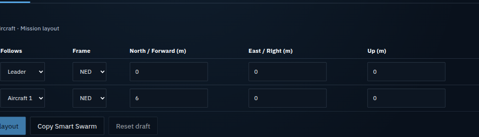
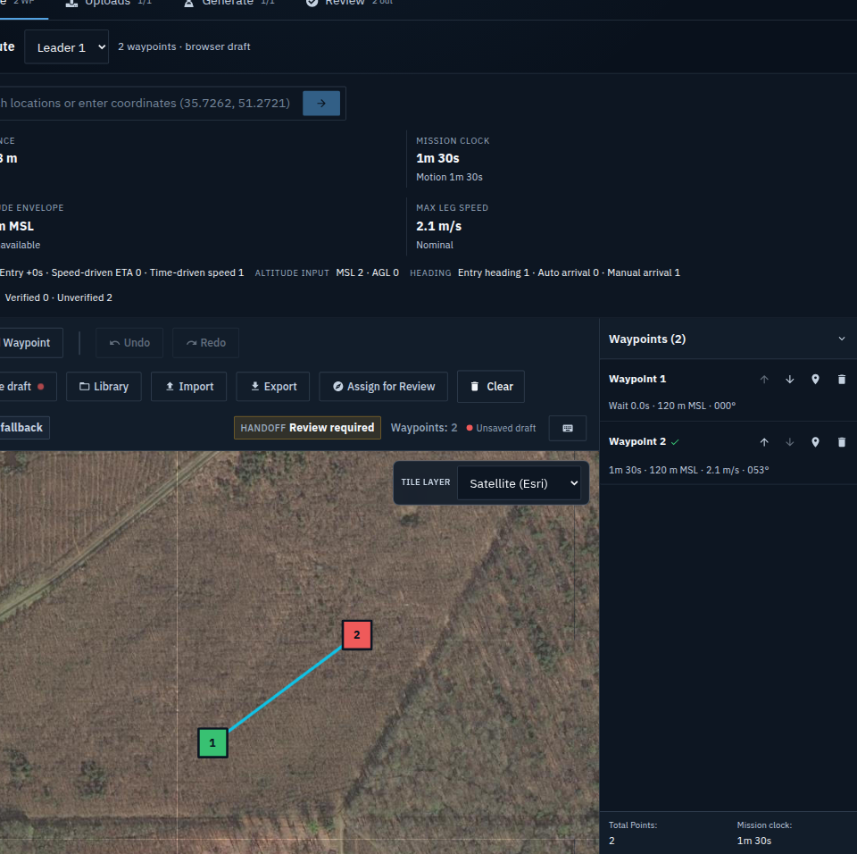
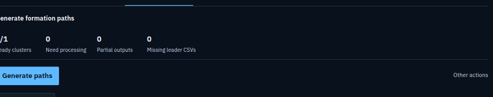
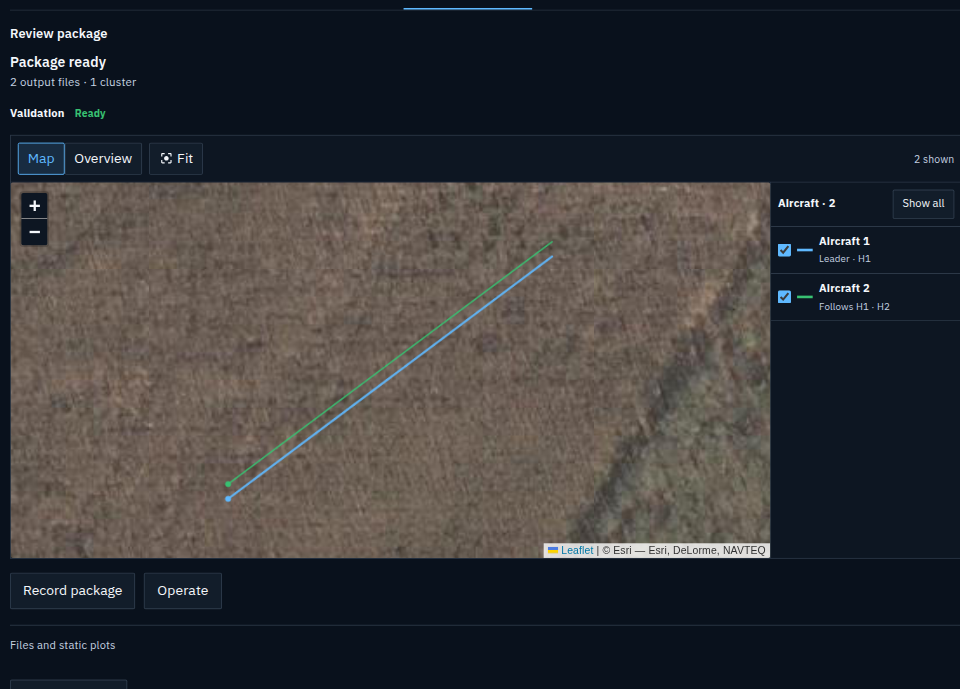
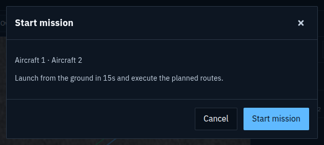
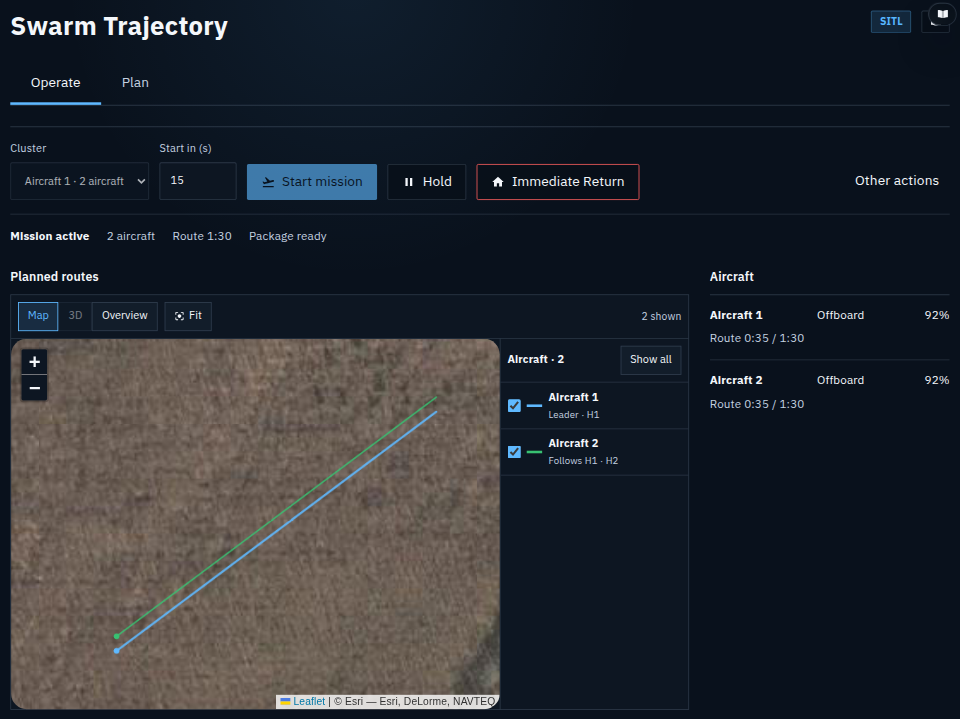
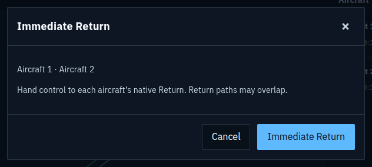

# Swarm Trajectory

Status: active hardening and operator validation
Mission type: `4` (`SWARM_TRAJECTORY`)
Primary page: `Swarm Trajectory` (`/swarm-trajectory`), with `Plan` / `Operate` tabs
Legacy `/trajectory-planning` bookmarks redirect to `Plan`; there is one route editor.

Swarm Trajectory is the MDS global-coordinate trajectory workflow for processed leader/follower swarm missions. It is different from QuickScout: QuickScout produces PX4 Mission-style SAR packages, while Swarm Trajectory processes precise leader routes into per-drone MDS trajectory files for coordinated Mission Type 4 execution.

Related docs:

- [Mission Planning Workspace](mission-planning-workspace.md)
- [Smart Swarm](smart-swarm.md)
- [Telemetry Altitude Policy](../guides/telemetry-altitude-policy.md)
- [Dashboard Operator Guide](../guides/dashboard-operator.md)
- [Mapbox Setup](../guides/mapbox-setup.md)

## Operator Workflow

**Plan → Formation → Route → Generate → Review → Operate.**
Planning and assigning routes do not arm aircraft. Unlike live Smart Swarm, this
mission starts from the ground and executes precomputed paths.

These screenshots show the candidate UI with simulated two-aircraft SITL data;
they do not establish real-flight readiness. Coordinated Pause/Resume is not
enabled in this checkpoint.

### 1. Choose the mission formation

Open **Plan → Formation**. Check aircraft, leader links, frame and offsets, then
**Save mission layout**. **Copy Smart Swarm** only imports a draft; it does not
change live Smart Swarm.

On first use, this is already the current Smart Swarm layout as an unsaved draft.
Save it unchanged for the clean default, or customize the mission's links, frames
and offsets before saving. Later Smart Swarm edits do not change the saved mission
layout. Copy Smart Swarm is an explicit refresh, not continuous live linking.



### 2. Create and assign each leader route

In **Route**, choose the leader. Add waypoints on the map, edit coordinates or
drag points; Undo/Redo restores edits. Use preferred-speed timing for normal
authoring, fixed arrival times only when required. MSL is entered directly;
AGL requires verified backend terrain.

Use the assignment control and confirm its leader. After acknowledgement the
workspace opens **Generate**. Repeat for other leaders when needed.

**Save draft / Library** use the browser route library, not aircraft or repository
sync. Import/Export are available here; **Uploads** is the alternate raw-CSV path.



### 3. Generate the formation paths

Open **Generate** and choose **Generate paths**. This generates follower
paths from the assigned leader routes and mission Formation. Wait for the job's
actual result; indeterminate progress is not a percentage or a success signal.



### 4. Review and synchronize

Open **Review**. Check validation, cluster paths, altitude/time envelope and
available plots before continuing. Fix a reported blocker and regenerate when
needed.

Review opens a geographic **Map**, with **Overview** for a basemap-independent
path sketch. Select aircraft in the legend to show/hide paths; use **Fit** to
frame visible routes. Colors and hardware identities stay stable when filtering.
Large fleets have a searchable, scrollable legend.

Saved files without a current formation assignment appear under **Outside
mission**, hidden by default. They are not counted as followers or selected for
launch. Inspect them explicitly if needed; review does not
silently delete retained files or assign new aircraft.

**Publish package** records and pushes to the configured repository.
**Record package** only records it on this GCS. Neither is the browser
library's Save draft. Same-host SITL can share generated files; hardware deployments must
synchronize and verify the matching package on the nodes before launch.



### 5. Review and start

Open **Operate**, select the complete cluster and confirm every aircraft is
fresh, disarmed and on the ground. Set the start delay, choose **Start mission**,
review the targets and confirm. This command includes takeoff and route execution;
do not manually take off first for Mission 4.



### 6. Monitor execution

Watch mission phase, aircraft mode, battery and route progress. Route time is the
commanded execution clock, not a measured tracking-accuracy claim. Stale progress
or missing telemetry requires investigation, not an assumption of completion.



### 7. End or return

| Control | Result |
|---------|--------|
| **Hold** | Ends the current route and requests Hold. Resume is not enabled yet. |
| **Immediate Return** | Hands control to each aircraft's native PX4 RTL. |
| **Other actions → Managed Return** | Confirms Hold, then dispatches RTL sequentially; default interval 10 seconds. |

Managed Return is a timed dispatch sequence, not collision avoidance. RTL paths
may overlap; a delay is not a guarantee that the previous aircraft has landed.



If a Start receipt is uncertain, use **Recover receipt** to recover the original
request identity; do not create repeated new starts. Clear/reset is only for
intentionally removing a package.

The old basic map/form editor has been removed. Existing route-editor bookmarks
open the same mission Plan, and the browser library uses its existing storage keys.
Scoped drafts do not use the former global autosave/pruning behavior.

Terrain verification is explicit: absent or failed verification stays unverified
through library and CSV roundtrips. Legacy files cannot gain terrain authority
merely by being saved again. Re-resolve old AGL routes before field use; a historical
`true` flag written by an older client is not independent terrain evidence.

## Product Semantics

Swarm Trajectory uses global latitude/longitude and stored MSL altitude throughout the processed package.

| Concept | Meaning |
|---------|---------|
| Leader route | The operator-authored path for a top leader. |
| Follower path | A generated per-drone route derived from the leader route and mission-owned formation offsets. |
| Cluster | A top leader plus the followers that depend on it directly or through a nested chain. |
| Validation | Backend readiness truth for commit/transfer/launch review. |
| Preview | Downsampled processed paths and cluster relationships for visualization. |
| Commit | Git record/sync boundary for generated artifacts, not a safety guarantee by itself. |
| Operate Start | Mission Type 4 dispatch using the same command tracking and node readiness as other control surfaces. |

This mode is not live Smart Swarm. Smart Swarm is the live leader/follower control mode. Swarm Trajectory generates individual per-drone files before execution.

## Safety Model

Swarm Trajectory is MDS/offboard-style trajectory execution. PX4 Offboard-style operations require continuous external setpoint proof-of-life and position/pose data appropriate to the setpoints. MDS runtime code owns that execution behavior; the planner must make the route package explicit before the operator dispatches it.

Operator-visible safety rules:

- Only top leaders are authored or uploaded manually.
- Follower outputs are generated from the mission-owned hierarchy and offsets.
- Validation blocks commit/transfer when the processed package cannot be trusted.
- Unknown swarm structure, missing clusters, missing leader uploads, stale processed outputs, and missing processed drones are blockers.
- Partial outputs are visible as partial, not launch-ready.
- AGL is an authoring convenience. The package stores MSL altitude.
- Terrain/elevation lookup failure blocks AGL waypoint save unless the operator switches to MSL input.
- The first waypoint is the route entry anchor; later waypoints define route motion.
- Start requires fresh native Disarmed + On-ground evidence at preparation,
  commit and executor entry. It does not switch an airborne vehicle into a
  ground-start mission. A rejected pre-ownership start sends no flight-control
  commands or landing/disarm cleanup.
- Map-authored waypoints default to automatic ETA and automatic arrival yaw after the route-entry anchor.
- Fixed-time waypoints calculate required inbound speed and are blocked when they exceed the configured safe envelope.
- Server dispatch and node checks remain authoritative; green UI is not an arming guarantee.

The mission formation is saved as `swarm_trajectory/formation.json`. Before its
first save, live formation data is offered as a draft; first processing snapshots
it. Later live Smart Swarm changes do not alter this mission. Saving a different
mission layout invalidates generated outputs and requires regeneration.

Operate reports per-aircraft native flight state and commanded route time. Route
time is execution evidence, not measured spatial tracking accuracy. Reports are
command-scoped, rate-limited and marked stale when unavailable. Route completion
is separate from the configured return/landing behavior and terminal confirmation.
Unconfirmed Start requests retain their identity across refresh and require an
explicit `Recover receipt` action; opening this page never dispatches a command.
The current interim Hold is terminal; coordinated Pause/Resume is not enabled yet.
Active tracked trajectory missions reject package-mutating API requests.

The aircraft loads and validates its processed route before arming or entering
Offboard. Invalid rows reject the entire file instead of being skipped. Global
coordinates and motion values must be finite, altitude must be explicit, and
timestamps must be nonnegative and strictly increasing. Leader CSV imports use
the same strict timestamp rule. These checks validate input integrity; they do
not establish terrain clearance or collision-free flight.

Every launch also checks canonical package readiness on the server, including
explicit whole-fleet requests. Missing validation or a stale/incomplete package
rejects dispatch; warnings alone do not. Processing sessions record output content
hashes, so modifying, adding or removing generated CSVs requires regeneration.
Older sessions without output hashes must be regenerated once before launch.

GCS dispatch attaches `swarm_trajectory: {revision, files}` to Mission 4 commands.
`files` maps hardware IDs to SHA-256 hashes of reviewed generated CSVs. Updated
nodes require this identity for managed launches and reject a missing/mismatched
file before arming. The executor parses the same bytes it hashes, retaining the
loaded trajectory in memory for the run. Files generated for hardware IDs are not
selected using Drone Show position-slot assignments. Update server and nodes
together and regenerate legacy packages before field testing; old nodes may reject
the new command field. Direct CLI validation remains available independently.

Regeneration builds a candidate away from active output files. Failed or partial
generation preserves the previous package; a complete replacement is published
with its session written last. Publication errors roll back outputs and session.
If rollback itself fails, the error identifies retained recovery files. This is
not an atomic multi-directory switch or an active-flight revision-pinning contract.
Inputs changed during generation prevent publication under a new input identity.

Route drafts are isolated by leader and REAL/SITL mode and recovered from browser
storage when available. Switching leader does not reassign the previous draft.
Blank coordinates are invalid; explicit zero latitude/longitude is valid.

## Altitude And Terrain

| Mode | Operator enters | Stored in mission package | Failure behavior |
|------|-----------------|---------------------------|------------------|
| `MSL` | Mean sea level altitude | Entered MSL altitude | Validated against altitude bounds. |
| `AGL` | Target clearance above terrain | Terrain elevation plus target AGL as MSL | Blocks if terrain/elevation is unavailable for the waypoint. |

Terrain assistance is waypoint-based. It is not full continuous terrain-following across every point of every long segment. Long routes over changing terrain need denser waypoint sampling or a later dedicated terrain-follow validation pass.

Swarm Trajectory AGL authoring uses the backend elevation endpoint, not the visual map widget, so Mapbox and Leaflet follow the same terrain contract. If the backend terrain provider cannot resolve a point, the AGL save is blocked instead of silently substituting an estimate.

Sea-level terrain references are valid. A resolved ground elevation of `0.0 m MSL` must not be treated as missing data.

## Degraded Conditions

| Condition | Expected operator state |
|-----------|-------------------------|
| No Mapbox token | Leaflet fallback remains available. |
| Terrain provider unavailable | AGL waypoint authoring blocks with a specific terrain error; MSL authoring remains available. |
| No valid processed package | Validation reports blockers; commit/transfer is blocked. |
| Missing leader upload | The leader/cluster is shown as missing upload; processing cannot make a complete package. |
| Partial follower output | The affected cluster is shown as partial; review and reprocess before launch. |
| Processing takes too long | The async processing job dialog shows progress, can request cancel, and ends in a bounded terminal state. |
| GCS restart during processing | In-memory job state can be lost. Raw and processed trajectory files remain on disk. |
| Degraded telemetry | Planning artifacts remain reviewable, but Dashboard launch readiness depends on live command/telemetry truth. |

## API Surface

The canonical API namespace is `/api/v1/swarm-trajectories/*`. The old versionless `/api/swarm/...` family is retired and should not be reintroduced.

| Method | Endpoint | Purpose |
|--------|----------|---------|
| `GET` | `/api/v1/swarm-trajectories/leaders` | Read top leaders, follower hierarchy, and upload status. |
| `GET` | `/api/v1/swarm-trajectories/workspace` | Read package review, preview, mission layout and launch identity. |
| `GET` | `/api/v1/swarm-trajectories/operation` | Read tracked execution/recovery and fresh per-aircraft reports. |
| `GET` / `PUT` | `/api/v1/swarm-trajectories/formation` | Read/save independent mission layout using revision conflict detection. |
| `POST` | `/api/v1/swarm-trajectories/upload/{leader_id}` | Upload one leader CSV. |
| `GET` | `/api/v1/swarm-trajectories/status` | Read raw/processed/plot counts and cluster state. |
| `GET` | `/api/v1/swarm-trajectories/recommendation` | Read whether processing is needed. |
| `POST` | `/api/v1/swarm-trajectories/process` | Synchronous compatibility processing path. |
| `POST` | `/api/v1/swarm-trajectories/process/jobs` | Create an asynchronous processing job. |
| `GET` | `/api/v1/swarm-trajectories/process/jobs/{job_id}` | Read job status, progress, result, or error. |
| `POST` | `/api/v1/swarm-trajectories/process/jobs/{job_id}/cancel` | Request processing-job cancellation. |
| `GET` | `/api/v1/swarm-trajectories/validate` | Validate processed package readiness. |
| `GET` | `/api/v1/swarm-trajectories/preview` | Read downsampled per-drone paths and cluster preview data. |
| `POST` | `/api/v1/swarm-trajectories/elevation/batch` | Resolve terrain/elevation for waypoint authoring. |
| `GET` | `/api/v1/swarm-trajectories/policy` | Read planner limits/defaults from backend params. |
| `POST` | `/api/v1/swarm-trajectories/clear-processed` | Clear processed outputs and plots. |
| `POST` | `/api/v1/swarm-trajectories/clear` | Clear raw, processed, and plot artifacts. |
| `POST` | `/api/v1/swarm-trajectories/clear-leader/{leader_id}` | Clear one leader upload and dependent outputs. |
| `DELETE` | `/api/v1/swarm-trajectories/remove/{leader_id}` | Remove one leader upload and dependent outputs. |
| `POST` | `/api/v1/swarm-trajectories/clear-drone/{drone_id}` | Clear one processed drone output and stale plots. |
| `GET` | `/api/v1/swarm-trajectories/download/{drone_id}` | Download one processed drone CSV. |
| `GET` | `/api/v1/swarm-trajectories/download-kml/{drone_id}` | Download one drone KML. |
| `GET` | `/api/v1/swarm-trajectories/download-cluster-kml/{leader_id}` | Download one cluster KML. |
| `POST` | `/api/v1/swarm-trajectories/commit` | Commit/push or locally record generated artifacts according to GCS writeback mode. |
| `GET` | `/api/v1/swarm-trajectories/plots/{filename}` | Serve generated plot images. |

Processing job state is in memory. A GCS restart may lose active job status, but raw uploads and processed artifacts remain in the configured trajectory workspace.

## CSV Contract

Leader input CSV columns:

```csv
Name,Latitude,Longitude,Altitude_MSL_m,TimeFromStart_s,EstimatedSpeed_ms,Heading_deg,HeadingMode,AltitudeReference,TargetAgl_m,GroundElevation_m,TerrainAccurate,TimingMode,PreferredSpeed_ms,CalculatedHeading_deg
WP1,35.000000,51.000000,120.0,0.0,0.0,25.0,manual,MSL,0.0,0.0,true,manual_time,8.0,25.0
WP2,35.001000,51.002000,125.0,45.0,8.0,63.0,auto,MSL,0.0,0.0,true,auto_speed,8.0,63.0
```

The first eight columns remain compatible with older leader CSVs. The trailing metadata columns preserve modern authoring intent for altitude, terrain, timing, and heading review.

`TimingMode=auto_speed` means the operator supplied preferred speed and the planner derived `TimeFromStart_s`. `TimingMode=manual_time` means the operator pinned the time and the planner derived required speed for review. `HeadingMode=auto` stores the calculated inbound arrival yaw; `HeadingMode=manual` stores the operator-owned heading.

Processed output CSVs are generated per drone and include time, global position, velocity, acceleration, yaw, mode, and LED fields used by the runtime trajectory executor.

## File Layout

```text
shapes/ or shapes_sitl/
  swarm_trajectory/
    raw/
      Drone 1.csv
    processed/
      Drone 1.csv
      Drone 2.csv
    plots/
      drone_1_trajectory.jpg
      cluster_leader_1.jpg
      combined_swarm.jpg
```

Same-host SITL may use a shared `shapes_sitl/swarm_trajectory/` workspace so the GCS and containers see the same generated files without dirtying container repos. Hardware and remote deployments still require the normal commit/push/sync flow.

## Implementation Map

Backend:

- `gcs-server/api_routes/swarm_trajectory.py`
- `functions/swarm_trajectory_service.py`
- `functions/swarm_trajectory_processor.py`
- `functions/swarm_trajectory_utils.py`
- `functions/swarm_global_calculator.py`
- `functions/swarm_analyzer.py`
- `functions/swarm_plotter.py`
- `gcs-server/schemas.py`

Frontend:

- `app/dashboard/drone-dashboard/src/pages/SwarmTrajectory.js`
- `app/dashboard/drone-dashboard/src/pages/TrajectoryPlanning.js`
- `app/dashboard/drone-dashboard/src/components/trajectory/`
- `app/dashboard/drone-dashboard/src/components/mission-planning/`
- `app/dashboard/drone-dashboard/src/services/droneApiService.js`
- `app/dashboard/drone-dashboard/src/services/gcsApiService.js`
- `app/dashboard/drone-dashboard/src/utilities/trajectoryTerrainContext.js`

Runtime:

- `swarm_trajectory_mission.py`
- `src/drone_setup.py`
- `src/params.py`

Tests:

- `tests/test_swarm_trajectory_service.py`
- `tests/test_gcs_swarm_trajectory_routes.py`
- `app/dashboard/drone-dashboard/src/pages/SwarmTrajectory.test.js`
- `app/dashboard/drone-dashboard/src/pages/TrajectoryPlanning.test.js`
- `app/dashboard/drone-dashboard/src/utilities/trajectoryTerrainContext.test.js`

## Validation Checklist

Before field handoff or a serious SITL demo:

- Author a two-or-more-waypoint leader route on the Swarm Trajectory page.
- Confirm map clicks select the new waypoint and populate latitude, longitude, altitude, time, speed, and heading fields.
- Edit, delete, select from the map, and reorder waypoints.
- Confirm ETA, required speed, climb/descent, and heading summaries reflow after each route change.
- Save a waypoint in MSL mode.
- Attempt AGL mode with terrain available and verify derived MSL output.
- Attempt AGL mode with terrain unavailable and verify it blocks with a clear error.
- Assign the route to a top leader.
- Process through the async job dialog and verify success, failure, and cancel behavior where possible.
- Review validation blockers/warnings/advisories.
- Verify leader and follower preview paths, clusters, and role labels.
- Commit outputs in the intended writeback mode.
- Launch from Dashboard Mission Type 4 only after readiness is clear.
- Clear/reset the package and verify validation returns to missing-upload/missing-output state.
- Repeat with no Mapbox token to confirm Leaflet fallback.

## Explicit Deferrals

- Full automated multi-drone deconfliction is not complete.
- Terrain assistance is waypoint-based, not full continuous terrain-following.
- Advanced automated replanning after a route or cluster fault is not complete.
- In-memory processing jobs are acceptable for bounded UI progress, but durable job state is a future backend hardening item.
- No-GPS/VIO execution beyond display and readiness signaling remains a runtime-specific validation topic, not a global-route planner guarantee.

## External Design References

- [PX4 Offboard Mode](https://docs.px4.io/main/en/flight_modes/offboard.html)
- [PX4 Mission Mode](https://docs.px4.io/main/en/flight_modes_fw/mission.html)
- [QGroundControl Plan View](https://docs.qgroundcontrol.com/master/en/qgc-user-guide/plan_view/plan_view.html)
- [NASA Display Standard](https://www.nasa.gov/reference/appendix-f-vol-2/)
- [NIST Public Safety UAS Portfolio](https://www.nist.gov/ctl/pscr/research-portfolios/uncrewed-aircraft-systems)
