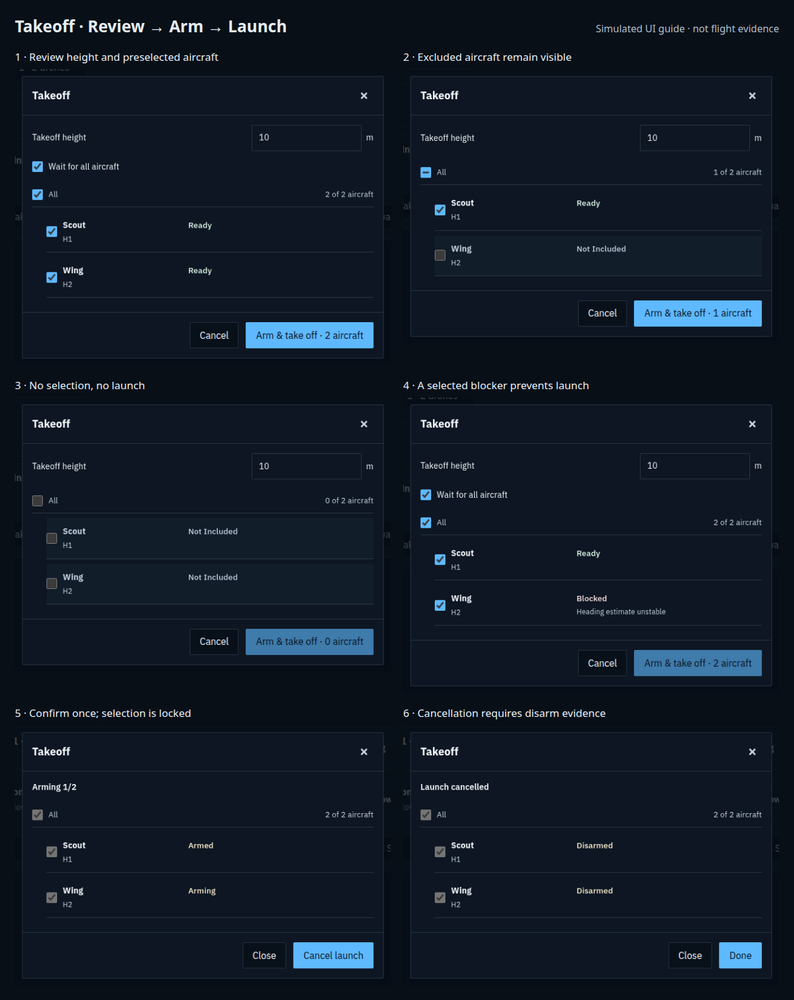

# Takeoff with all aircraft ready

Dashboard, Smart Swarm and aircraft-card Takeoff controls open the same review.
Takeoff does not start following; start Smart Swarm separately after both aircraft
are airborne and settled.

## Operator steps

1. Select the aircraft or complete swarm cluster and choose **Takeoff**. The
   initiating page's aircraft are already checked; unrelated aircraft are not
   added to this review.
2. Set **Takeoff height**. Check the names and live readiness rows. Aircraft
   checkboxes only control inclusion in this Takeoff.
3. Check the aircraft count. Untick an aircraft only if it should not take off;
   its row stays visible as **Not included**. **Select all** and **Clear** change the
   review roster. Resolve selected **Blocked** or **Unavailable** rows before
   confirming; **Checking** is not permission to launch.
4. For a group, leave **Launch mode → All armed first** selected unless you
   intentionally want **Independent** execution. Clear the launch area, then
   choose **Arm & take off** once. Motors may start
   during arming. There is no second confirmation while aircraft are armed.
5. Watch **Arming → Taking off → Airborne**. Before launch release,
   **Cancel launch** cancels the operation; **Close** only closes the dialog.
6. Verify each aircraft's actual flight state before starting Smart Swarm.

Selection locks on confirmation. Excluding an aircraft affects only this
Takeoff, not the saved formation or the complete-cluster **Start Swarm** action.
No aircraft is automatically excluded because it is blocked. An uncertain
submission retains its exact selected subset for receipt recovery, including
after closing and reopening the same review.

The captures below use simulated browser responses, not real aircraft telemetry.

Full-size views: [Ready](../assets/coordinated-takeoff/01-ready.png),
[Blocked](../assets/coordinated-takeoff/02-blocked.png),
[Arming](../assets/coordinated-takeoff/03-arming.png),
[Cancelled](../assets/coordinated-takeoff/04-cancelled.png).

If arming fails, the group receives no takeoff release. The system cancels the
attempt and normally disarms aircraft it armed when fresh telemetry confirms
they are still on the ground. An unconfirmed recovery requires pilot attention;
it is not displayed as successful disarming. Retry is always an explicit action.

**All armed first** coordinates arming and launch release. It cannot make
independent PX4 aircraft take off atomically. A rejection or communications failure
after release can still produce a partial launch. Pending releases are cancelled;
conditional Hold recovery must not override pilot takeover, a newer command or
native Return/Land. The failed aircraft retains its own failed-climb recovery.

Choosing **Independent** explicitly selects independent Takeoff. It does not bypass
PX4 preflight checks. Single-aircraft Takeoff keeps its existing execution path.
The dialog shows **Single aircraft** when only one is selected. Re-selecting a
group restores its previous mode. After confirmation, a compact height/mode
summary replaces the settings; bulk-selection actions are hidden.

## Deployment and verification

Coordinated Takeoff requires supporting GCS and node software. Unsupported nodes
are identified before launch; the GCS never silently substitutes independent
execution. Both official and private deployments must verify the actual node
revision before field acceptance. This does not require changing PX4 preflight,
formation, controller gains, or automatic disarm parameters.

The node reads its actual `COM_DISARM_PRFLT` before arming and bounds its own wait
inside the usable window. PX4 automatic disarming remains a backup. Loss of GCS
connectivity cannot extend the armed wait indefinitely. Runtime timing defaults
live together in `Params.COORDINATED_TAKEOFF_*`, not in per-page UI rules.

Protocol messages are bound to the existing command identity and per-aircraft
callback capability. Freshness challenges, bounded leases and a shared release
time prevent old readiness reports from authorizing a new launch. The command
journal records decisions; restored commands never regain old release authority.

## API contract

- `POST /api/v1/commands`: standalone Takeoff accepts `takeoff_mode`:
  `coordinated` or `independent`. Groups default to coordinated; single targets
  use independent execution. The reviewed mode is part of command identity.
- `GET /api/v1/commands/takeoff-readiness?target_drone_ids=1&target_drone_ids=2`:
  read-only native per-aircraft readiness, capability support and remaining
  freshness lease. No arming or dispatch occurs.
- `POST /api/v1/commands/{command_id}/cancel-launch`: operator-authorized
  cancellation before release. Closing a browser dialog does not call it.
- `POST /api/v1/command-reports/takeoff-stage`: node-only stage exchange,
  authenticated using the existing command-report capability header. It does
  not grant a general Arm or Takeoff capability.
- Existing command status includes `coordinated_takeoff`, a sanitized progress
  projection. Internal challenges and credentials are never operator fields.
- Conditional `HOLD` may carry `expected_control_command_id` for group-failure
  recovery. The node rechecks current ownership and fresh native takeoff state
  before allowing it. This is not an operator override or a general bypass.

Browser screenshots are simulated UI evidence, not proof of flight behaviour.
Before hardware acceptance, validate success, rejected arming, cancellation,
communications loss and partial-launch recovery in two-aircraft SITL.

### Current source-candidate acceptance

Two-node PX4 SITL passed a successful all-armed launch, immediate cancellation,
cancellation after an aircraft armed, and native PX4 preflight rejection. The
test source was overlaid onto the stock image; it is not a newly distributed
image or hardware-flight approval. Tests cover additional stale-data,
lost-response, ownership and restart cases, but not all have live fault-injection
evidence yet.

Repeated native readiness probes after landing can intermittently miss SDK
telemetry despite fresh MAVLink input. This remains an acceptance issue; closing
the connection iterator fixes a proven cleanup omission, not the whole defect.
An unavailable sample is not a proven PX4 preflight rejection and must not be
treated as Ready. See the [implementation checkpoint](../plans/2026-10-30-coordinated-takeoff-checkpoint.md)
for evidence and the remaining release boundary.
