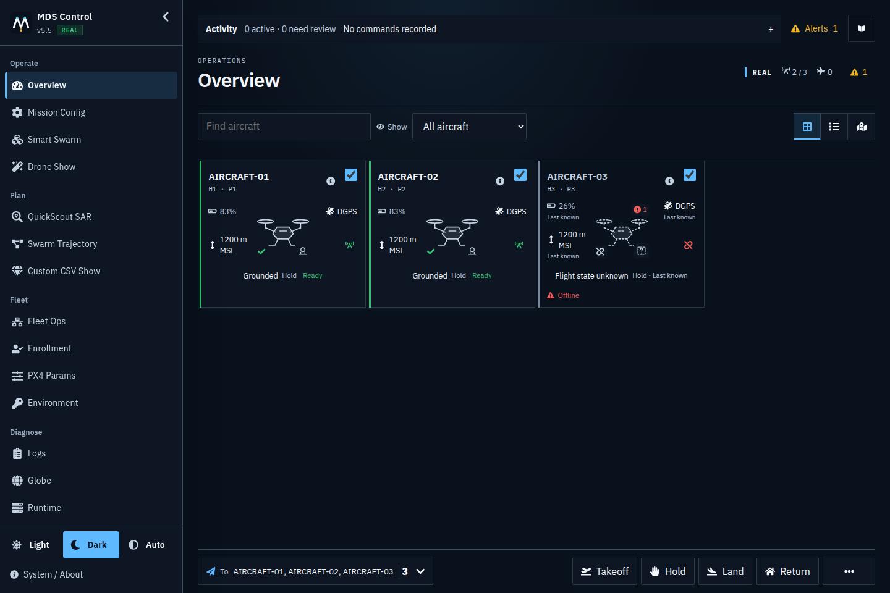
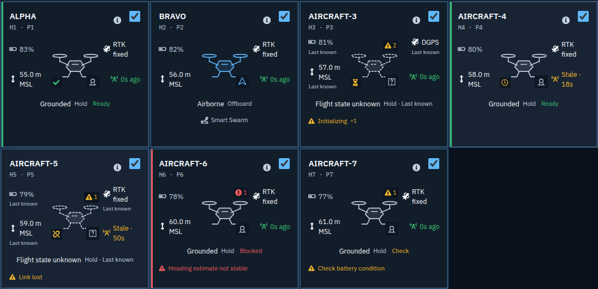
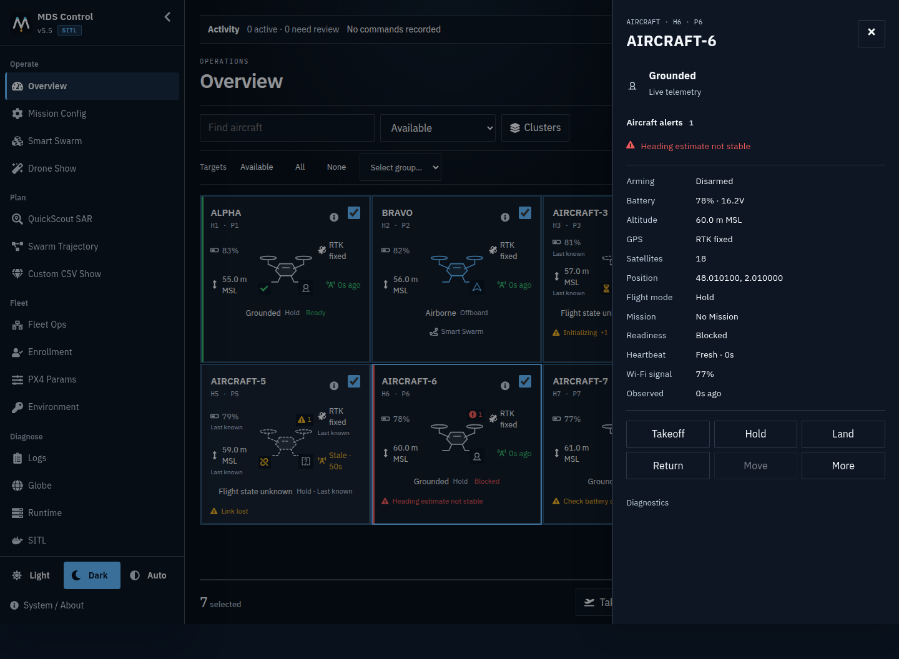
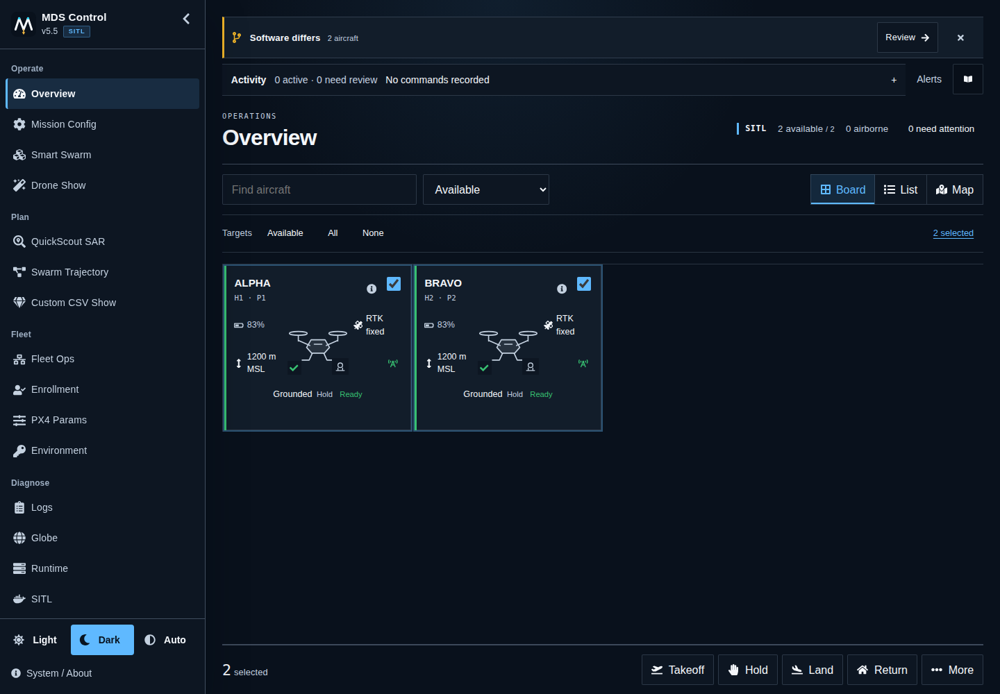
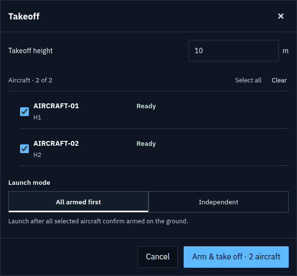
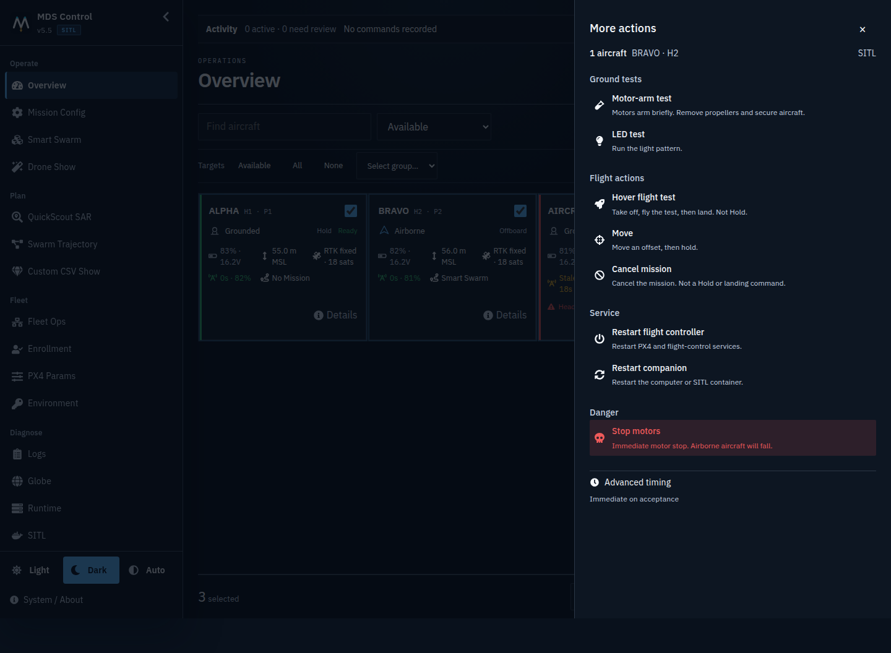
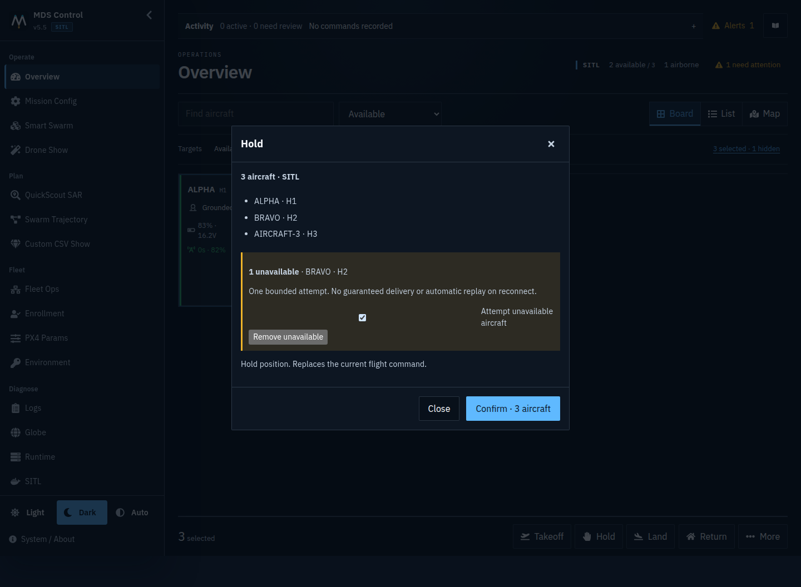
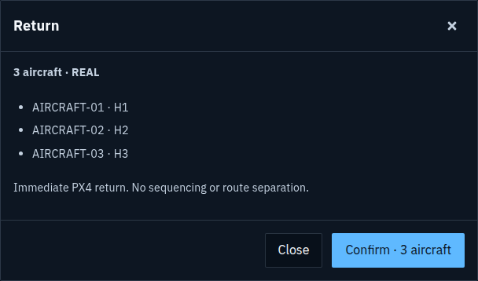
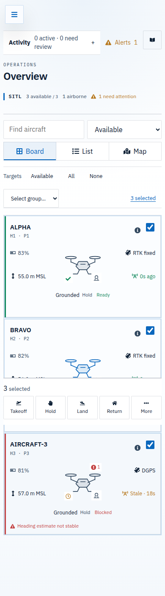

# Overview operator guide

Use **Overview** to check the fleet and send general aircraft commands. Set up,
start and monitor missions on their own pages: **Smart Swarm**, **Drone Show**,
**Custom CSV Show**, **Swarm Trajectory** or **QuickScout**.

[Open the four-step illustrated guide](../assets/operator-overview/overview-operator-guide.png).
The screenshots use a synthetic fleet, not aircraft clearance.

## Check the aircraft

1. Confirm **REAL** or **SITL** at the top of the page.
2. Check the available-aircraft and attention counts.
3. Open an aircraft card to inspect current measurements
   and any issue. Inspection does not select it for commands.

**Available** is the initial filter: an accepted heartbeat in the last minute.
After ten seconds without a heartbeat the card dims and shows a clock; after
one minute it leaves Available. **All aircraft** still includes it, and
**Selected targets** finds selected aircraft even when no longer available.
These display windows are configurable; they are not flight-readiness checks.

**Board** is the initial view. **List** compares aircraft in compact rows;
**Map** shows current trusted positions. Switching views keeps the same targets.
Aircraft without current positions remain in the list; the map provides a link
to find them. A map marker opens inspection, not command selection.

Callsigns are shown when configured; **H1**, **H2**, etc. identify the physical
aircraft even when names are duplicated. **P1**, **P2**, etc. identify position
slots. Each card centers an aircraft schematic with a small phase marker for
grounded, airborne, taking off, landing or unknown. The illustration is not an
airframe footprint, heading or proof that motors stopped. Battery percentage and
altitude/datum sit on the left; GNSS fix and stable link state on the right. Exact
heartbeat age and Fresh/Stale labels remain in the link hint and inspector
diagnostics. The card uses radio/clock/disconnected symbols, with measured Wi-Fi
percentage only when current. Tap the card for details on touch devices.
The inspector also shows the **Configured IP**; this is an address
from the shared fleet model, not proof that the aircraft is reachable. The
current state/mode and any active mission appear below. Only actual issues add
warning text. Tap/click the card for satellites, voltage and full measurements.
The **Network** detail names the companion-reported primary transport: Wi-Fi,
Ethernet, cellular or USB network. Its icon matches the transport; only current
Wi-Fi evidence shows a signal percentage. Older companions without a primary
link show their single known transport or **Multiple links** rather than guessing
which is in use. Missing evidence stays **Unknown**; stale transport is marked
**last known**. This is not proof of Internet latency or the VPN's route.
Unavailable card measurements use a dash, never an invented zero. Altitude
precision adapts to scale; its datum and full reading remain in the hint.
Small badges on the schematic distinguish initialization, stale/missing link
evidence and ground readiness. A severity-prioritized alert marker shows the
condition count; clicking it opens the same aircraft inspector with the full
reasons near the top. Viewing a condition does not acknowledge or clear it.

Flight modes use names; raw codes remain in inspection diagnostics. Wi-Fi percent
appears only when a fresh heartbeat actually reports it, not as inferred radio
range or end-to-end latency.

The compact **Software differs** notice compares source revisions with the GCS;
it is not a flight-health warning. **Version unavailable** is unconfirmed evidence,
not proof that an update is required. **Review** opens Fleet operations without
preparing or sending an update. Source updates belong to grounded maintenance.
Brief refresh failures keep the existing surface and measurements; older software
evidence becomes explicitly unavailable. No reconnect changes command targets.
Known source attention remains during the Available window instead of disappearing
and reappearing on a brief aircraft link loss. This is display continuity only;
Fleet operations still requires fresh evidence before an update.

[Phone view of the same workflow](../assets/operator-overview/software-review-phone-dark.png).

Fleet Map's 2D and 3D aircraft popups use the same transport labels and console
theme. **Details** reveals the configured IP, reported network/interface and last
telemetry time. Selecting another aircraft closes its previous action/jog review;
it cannot inherit a reviewed target. Source coordinates and map positioning are
not changed by this presentation update. A single bounded inspector serves the
2D map providers and 3D scene: right-side on desktop, bottom sheet on phones.
Expanded details scroll inside it instead of clipping behind the map boundary.

## Select command targets

A fresh browser session starts with the **available configured aircraft** selected
once the first configuration and heartbeat snapshot have loaded. Where a
saved selection is available for the same operator, GCS and runtime, it is
restored—including a deliberately empty selection.

- Check an aircraft's box to include or exclude it.
- **Available**, **All**, **None** and **Select group** are deliberate selection actions.
- Search and filters only change what you see. The selected count includes
  hidden aircraft. Click that count to show the selected set.
- Link loss, reconnects and newly discovered aircraft never change your targets.
- If a remembered aircraft no longer exists in the configuration, resolve the
  named missing target before dispatch. It is never silently replaced.

Unselected aircraft stay readable so their hazards are not hidden. Before
confirming an action, check its aircraft names and count again.

For multiple multi-aircraft formations, **Clusters** groups the display without
changing targets. It is hidden for a single formation; **Select group** is the
separate, explicit command-target control.

## Send a general command

| Control | Result |
| --- | --- |
| **Takeoff** | Opens the shared aircraft/height/readiness review. Groups default to **All armed first** before release. |
| **Hold** | Commands an airborne aircraft to hold its position; it does not take off. |
| **Land** | Lands at the aircraft's current position. |
| **Return** | Sends immediate PX4 RTL. No sequencing or route separation. |
| **More** | Ground tests, less-used actions and service controls. Read the action review before confirming. |

For an isolated intervention, inspect an aircraft and use its own controls.
These address that aircraft only, independently of the dashboard selection.
**Move** is available for a currently observed airborne aircraft. Its **More**
panel is scoped to that exact hardware ID, not the bulk selection. Opening a
panel freezes its target set; subsequent filtering or reconnects cannot retarget it.

If a new general action includes unavailable aircraft, the review names them.
**Remove unavailable** creates a reduced-target review without changing the main
selection. Alternatively, **Attempt unavailable aircraft** acknowledges one
bounded dispatch attempt to the exact targets. This is not deferred delivery or
automatic replay after reconnection. PX4/native checks still apply. Takeoff keeps
its own live readiness and coordinated-launch checks; this acknowledgment cannot
bypass them. An unconfirmed command can only be looked up, not edited or resent.

The motor-arm test is a physical test, not just a connectivity check. On real
aircraft, confirmation requires propellers removed, airframes secured and the
test area clear. PX4 and native action checks still apply.

**Return** on Overview is different from **Managed Return** on mission pages.
Managed Return can stagger RTL commands; it does not guarantee separated flight
paths. PX4 still controls each return and its configured return height.

## Read command progress

Open **Activity** to see recent commands, affected aircraft, execution progress
and rejection reasons. Activity remains available when you change pages and
rehydrates from GCS command history after a refresh.

Request acceptance is not completion. Check partial, rejected or unconfirmed
outcomes before retrying. An unconfirmed submission retains its request identity;
its **Check** control looks up the receipt without sending it again. An
unconfirmed request does not disable unrelated Hold, Land or Return actions;
their own target-bound reviews remain separate. Nothing automatically replays
when the connection returns.

Closing a review or monitor is not a command to stop an aircraft. Use the named
flight/recovery controls on Overview or the owning mission page.

**Alerts** keeps aircraft-condition episodes separate from command activity.
**Seen** acknowledges an alert; it does not clear the aircraft's condition.
When Overview is not providing current evidence, the panel says **Last
observed** with its age. It does not claim those conditions are current or
resolved. A GCS outage is one aggregate alert, not a repeating aircraft toast.

## Understand unavailable data

**Live** means current telemetry is available. **Heartbeat only**, **Link lost**,
**Offline** and **Never seen** identify different missing-evidence situations.
Configured aircraft remain inspectable when unavailable. **Unknown** does not
mean disarmed or landed.

Last-known measurements are marked; missing measurements stay unknown. GPS fix
type and usable map position are separate. **3D fix → DGPS → RTK float → RTK
fixed** are receiver fix classifications, not an instruction from PX4 to skip
RTK. An aircraft can report a GPS fix before a valid global position is ready.

Readiness in a review is action-specific. PX4 and the drone recheck at execution;
a green display cannot guarantee physical takeoff. Position uncertainty in
metres is different from stationary drift in metres/second. The dashboard does
not bypass PX4 drift, heading, estimator or arming checks.

## Tablet and phone

The same selection and confirmation rules apply. Navigation opens from the
menu button; inspection opens as a screen-sized panel. The selected count and
action rail remain accessible. Secondary information is available by tap and
keyboard as well as hover.

## Mission workspaces

| Mission | Next step |
| --- | --- |
| [Smart Swarm](../features/smart-swarm.md) | Review or capture the formation; use Operate for Takeoff, Start Swarm, Pause and Managed Return. |
| [Drone Show](../features/drone-show.md) | Import/review the package, check origin and launch slots, select targets/timing, then launch from Operate. |
| [Custom CSV Show](../features/drone-show.md#custom-csv-mode) | Review the shared local-frame CSV, select aircraft/timing and launch from its Operate tab. |
| [Swarm Trajectory](../features/swarm-trajectory.md) | Plan, generate and review the package, then Start from Operate. |
| [QuickScout](../quickscout.md) | Prepare the search package and use its own launch review and monitor. |

## Related guides

- [Coordinated Takeoff](coordinated-takeoff.md)
- [Fleet Ops](fleet-ops.md)
- [Telemetry altitude policy](telemetry-altitude-policy.md)
- [Runtime configuration](runtime-config-sources.md)
- [SITL Control](sitl-control.md)
