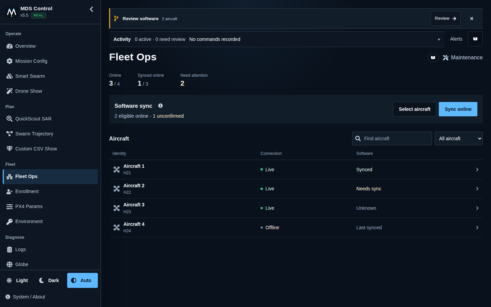
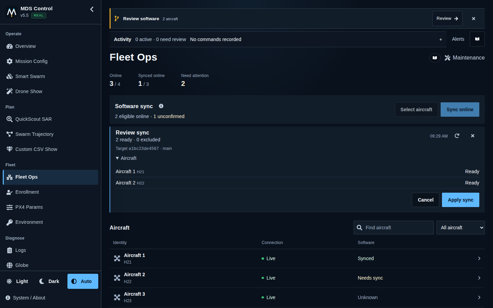

# Fleet Ops

Open **Fleet Ops** to see which aircraft are connected and which report the same software as the ground station. Select an aircraft row to inspect its hardware ID, revision, update branch and last check. An offline row shows its last observed software state when available, or **Unknown**. Hover, focus or tap the information icon beside **Software sync** for help with eligibility and selection.

1. Choose **Sync online** to preview all eligible online aircraft. To update a subset, choose **Select aircraft**, tick the intended aircraft and choose **Sync selected**. Searching or filtering the roster preserves your selection.
2. Check the aircraft identities and destination revision in **Review sync**. A recently lost heartbeat, unavailable revision or changed identity can exclude an aircraft. **Cancel** closes the preview. **Apply sync** starts the update for the reviewed recipients.
3. Leave the page if you need another dashboard. Returning to Fleet Ops in the same tab restores the operation. **Verified** means the GCS read the requested branch and exact target commit from that hardware ID, with a clean worktree and zero tracking drift. A partial result lists each unconfirmed aircraft.
4. If the connection drops, use **Refresh sync status** to read the existing receipt. A preview expires after five minutes. After a GCS interruption, review aircraft software before starting a fresh update.





[View the help control on a phone](../assets/fleet-ops/mobile-help.png).

A clean matching revision on another branch counts as synced when tracking is even. The branch name appears in aircraft details. To align it deliberately, go to **Maintenance → Repository access → Align branch** and review that aircraft.

The dashboard software notice opens a read-only review. A revision difference, local edits, tracking drift, an unavailable revision, or an explicit managed service/profile discrepancy can raise the notice. Each affected aircraft contributes once. The notice clears with the next shared status update.

**Maintenance** contains Wi-Fi profiles, MAVLink routing, per-aircraft repository access and service reports. The original Wi-Fi and MAVLink bookmarks still work. The GCS Runtime link opens host administration. Installations that use a separate Fleet Ops mutation token can set it under **Repository access → Maintenance token** for the current tab.

## Data Sources

Fleet Ops uses existing GCS APIs:

- `GET /api/v1/git/status`
- `GET /api/v1/fleet/heartbeats`
- `GET /api/v1/fleet/git-sync`
- `POST /api/v1/fleet/git-sync/dry-run`
- `POST /api/v1/fleet/git-sync/apply`
- `GET /api/v1/fleet/git-sync/operations/{operation_id}`
- `GET /api/v1/fleet/sidecars`
- `GET /api/v1/fleet/sidecars/{sidecar}`
- `GET /api/v1/fleet/sidecars/{sidecar}/baseline`
- `POST /api/v1/fleet/sidecars/{sidecar}/reconcile/dry-run`
- `POST /api/v1/fleet/sidecars/{sidecar}/reconcile/apply`
- `POST /api/v1/fleet/sidecars/{sidecar}/policy/dry-run`
- `POST /api/v1/fleet/sidecars/{sidecar}/policy/apply`

The git-status payload already includes per-node:

- repo branch and commit
- sync posture against the GCS
- repo access mode
- git auth health
- managed `mavlink-anywhere` status
- connectivity backend status
- sidecar desired/applied config hashes when reported by the node
- latest git-sync runtime summary

## Status Meaning

### Presence

Fleet Ops uses the canonical GCS presence contract from
`GET /api/v1/fleet/heartbeats`. Do not infer liveness from old git status
records; those are diagnostic records and can outlive a disconnected node.

Presence states:

- `never_seen`: configured/reporting identity exists, but this GCS runtime has no accepted heartbeat or telemetry evidence.
- `live`: heartbeat or telemetry is fresh enough for operator action.
- `recently_lost`: link dropped inside the short grace window; monitor for recovery.
- `stale`: link is older than the recent-loss window but not yet long-offline.
- `offline`: link has exceeded the stale threshold.
- `blocked`: link is live, but readiness/preflight blocks operation.

The thresholds are registry-backed GCS env keys:

- `MDS_PRESENCE_RECENT_LOSS_SEC`
- `MDS_PRESENCE_STALE_SEC`
- `MDS_PRESENCE_LONG_OFFLINE_SEC`

### Synced

The node reports the same revision as the GCS, a clean worktree and zero commits ahead or behind. Aircraft presence and flight readiness have their own indicators.

After a confirmed apply, Fleet Ops waits for the exact target branch and
commit, a clean worktree, and zero ahead/behind drift. The bounded verification
window defaults to 150 seconds through
`MDS_GCS_GIT_SYNC_VERIFY_TIMEOUT_SEC`. That budget covers the node's startup
jitter, fetch/reset, post-sync validation, runtime reconcile, deferred restart,
and final status polling. Nodes are checked concurrently, so the deadline is
not multiplied by fleet size. Override it only for a measured deployment path;
accepted values are 30 through 900 seconds, and invalid or out-of-range values
fall back to 150 seconds. Changing it requires a GCS restart.

Fleet Ops also surfaces the latest node-local git-sync runtime summary. If
`service_reload_status=warning` and a deferred action ends in
`manual_unit_update_required`, the repository sync succeeded but the node could
not install an updated systemd unit file with its current controlled sudoers.
Rerun the node installer or refresh sudoers before expecting service unit
changes to apply automatically.

For SITL containers, `service_reload_status=skipped` is expected. SITL does not
own real-node systemd units inside the git-sync path, so Fleet Ops treats that
state as healthy/not applicable rather than drift.

The **Review software** filter covers more than commit mismatch. It includes repository
drift, node-local git-sync runtime warnings, and sidecar desired/applied hash
drift so a synced commit cannot hide an unapplied service or profile update.

### Auth

Shows method and health only. Fleet Ops does not expose raw token values,
private key paths, or local secret paths in normal operator UI.

### MAVLink

For real nodes, this reports managed `mavlink-anywhere` posture when the node
provides it. For SITL, managed `mavlink-anywhere` is not expected because SITL
containers use embedded `mavlink-routerd`.

Fleet Ops treats `config_hash_match=false` as sidecar drift even when the
router service is active. That means the service may be running, but the last
recorded reconcile does not match the current desired sidecar ownership inputs.
The node also reports normalized sidecar contract fields when available:
`tool`, `mode`, `service_state`, `installed_ref`, `desired_hash`,
`applied_hash`, `local_hash`, `drift_state`, `profile_summary`, and
`last_apply_result`. Detail dialogs show sanitized MAVLink input sources and
fleet endpoints when the node has synced a release that reports them. These are
safe status fields; they do not contain Wi-Fi passwords, tokens, private keys,
secret-file paths, or raw profile bodies.

### Connectivity

If the fleet policy sets connectivity backend to `none`, Smart Wi-Fi Manager is
not expected and missing service state is not a failure. If a Smart Wi-Fi
backend is configured, service and profile status are shown as node compliance
signals.

`Profile missing` means the sidecar is installed/reported, but the repo-owned
fleet profile source configured for that node does not exist on the node
checkout. For private fleets, commit a sanitized or approved private baseline at
`config/fleet-profiles/smart-wifi-manager/config.json`, then use Fleet Ops
Wi-Fi profile preview/apply. For public demos, keep the backend `none`, use
sanitized placeholder profiles, or use a host-local profile source outside git.

When Smart Wi-Fi Manager is configured, Fleet Ops shows the resolved profile
hash plus desired/applied config hashes. Hashes are shortened in the UI for
operator readability; raw profile content and secrets are not displayed.

Fleet Ops Wi-Fi profile controls live at `/fleet-ops/wifi`. The table shows the
drone as `P{pos}|H{hw}`, presence, service state, installed ref, mode, profile
source, desired hash, local/applied hash, drift state, profile count, a compact
Wi-Fi Manager dashboard icon, and last apply result. The dashboard icon links to
the board-local Wi-Fi Manager dashboard on that node's sidecar port. The table
is intentionally compact; drift and last-apply values open the same reusable
detail view as the details icon. Baseline, node detail, promote-draft,
reconcile, and policy-mode changes are all dialog-based.

The Wi-Fi detail view shows Pos ID and HW ID as separate fields, the same Wi-Fi
Manager dashboard icon near the node facts, the repo baseline profiles, and node
Wi-Fi differences. Exact baseline matches are hidden from the node-difference
section to avoid duplicate rows, but same profile IDs with changed sanitized
fields remain visible so `local_extra` never appears unexplained. Operators may
see SSIDs, profile IDs, priority, disabled/autoconnect posture, and password
state values such as `stored`, `missing`, `external file`, or `redacted`.
Operators must not see raw passwords or local secret-file paths.

`local_extra` drift in Wi-Fi `fleet-merge` means the node has local profiles in
addition to the repo baseline. Fleet Ops keeps those profiles because they may
be field/emergency connectivity. To make a connected drone the new baseline,
open its redacted node summary, promote a sanitized reference draft, review the
draft with the operator, commit the approved baseline to
`config/fleet-profiles/smart-wifi-manager/config.json`, then run reconcile
preview and apply for selected drones. Do not copy raw passwords from node
profiles into docs, tickets, public repos, or screenshots.

Fleet Ops MAVLink profile controls live at `/fleet-ops/mavlink` and use the
same operator model. The fleet baseline owns shared endpoint policy; hardware
source settings such as UART device, baud, UDP input source, and PX4 port stay
node-local unless an operator deliberately changes them through node-local
MAVLink Anywhere tooling.

The MAVLink detail view shows Pos ID and HW ID as separate fields, sanitized
node-local input sources, node MAVLink endpoint differences, and the repo
MAVLink endpoint baseline, with a compact MAVLink Anywhere dashboard icon near
the node facts. Exact baseline matches are hidden from the node-difference
section; changed same-name endpoints remain visible. The dashboard icon links to
the board-local MAVLink Anywhere dashboard on that node's sidecar port. This is
for quick operator inspection; SITL routing remains separate and real-node
hardware sources are not overwritten by `fleet-merge`.

Promote Draft generates a sanitized reference draft only. It does not replace a
repo baseline or alter any node profile.

## Dashboard Links

Fleet Ops only opens a node sidecar dashboard when the node reports a direct
URL or a non-loopback listen address such as `0.0.0.0:9070` or
`0.0.0.0:9080`. A listen address such as `127.0.0.1:9070` is treated as
local-only and appears as a disabled icon with a tooltip. This avoids giving
operators broken NetBird links while still showing that the sidecar exists.

For a one-off diagnostic session, use SSH port forwarding or temporarily set a
node-local dashboard listen value, then run node sync/reconcile:

```bash
MDS_MAVLINK_ANYWHERE_DASHBOARD_LISTEN=0.0.0.0:9070
MDS_SMART_WIFI_MANAGER_DASHBOARD_LISTEN=0.0.0.0:9080
```

Do not expose sidecar dashboards on untrusted networks. Prefer NetBird, a local
field LAN, or a future GCS proxy surface.

## Related Guides

- [Fleet Sync And Secrets](fleet-sync-and-secrets.md)
- [Runtime Config Sources](runtime-config-sources.md)
- [Smart Wi-Fi Manager Dashboard](smart-wifi-manager-dashboard.md)
- [MAVLink Routing Setup](mavlink-routing-setup.md)
- [SITL Control](sitl-control.md)
