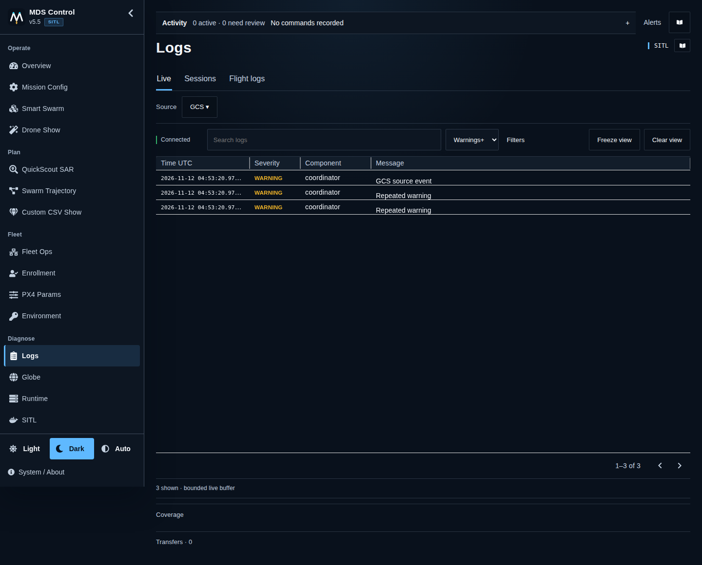
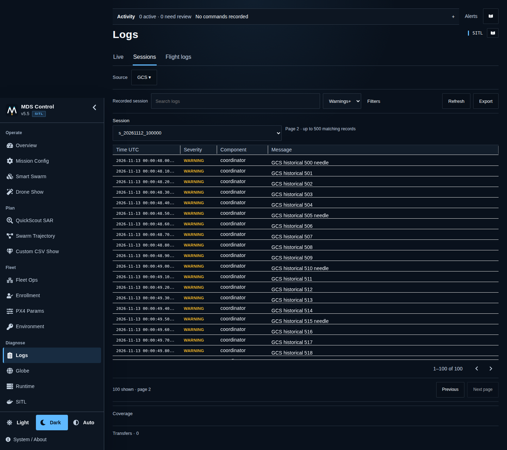
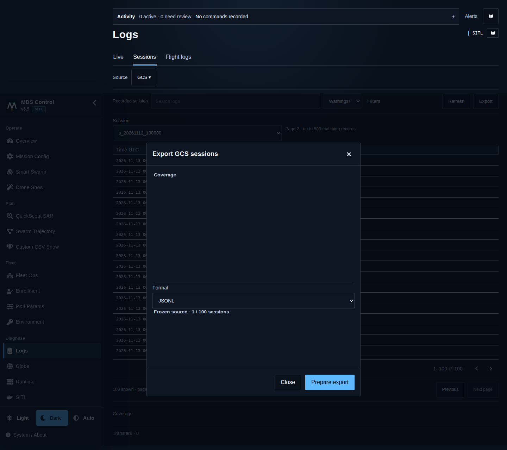
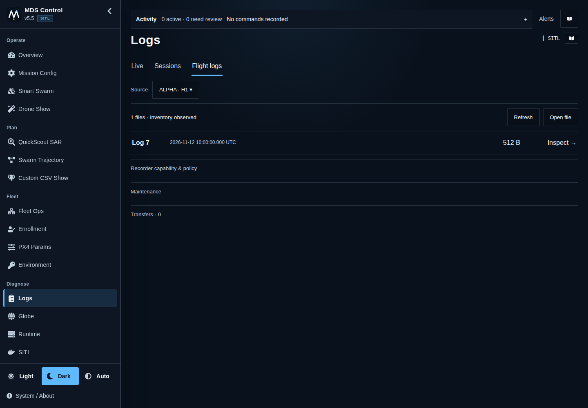
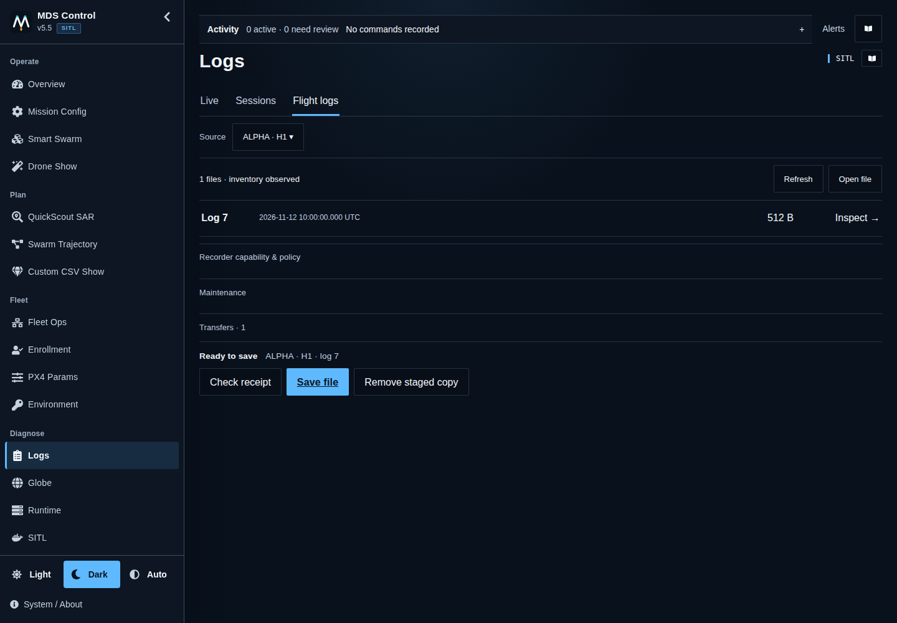

# Logs: operator workflow

Open **Logs** in the sidebar. Start with the tab matching your task; GCS is the
initial source. These screenshots use synthetic aircraft, not a live fleet.

| Task | Tab | Next action |
|---|---|---|
| Understand a current message | Live | Select a record |
| Review/export recorded MDS events | Sessions | Choose session → Export |
| Retrieve a PX4 recorder file | Flight logs | Choose aircraft → Inspect file |

## 1. Watch current events

**Warnings+** is the initial severity. Search immediately; use **Filters** for
component/time window. Select a message for full details. **Freeze view** freezes
the display only; missions and logging continue. **Follow latest** resumes it.
Connection and coverage labels describe this log stream, not aircraft readiness.

## 2. Review a recorded session

Choose **Source**, then **Sessions** and a session. Search and filters apply to
the recording before paging. Use **Next page** for more records. Time bounds are
explicitly UTC: **After** excludes its exact instant; **Through** includes it.
An expired/changed session view needs **Refresh**, not a different aircraft.

## 3. Export evidence

**Export** reviews the exact source and sessions. **Whole selected sessions**
ignores current filters; **Current filters** exports all matching records, not
just the current page. Select JSONL or ZIP; multiple sessions use ZIP. A skipped
record count means coverage is incomplete. Narrow an oversized export.

## 4. Choose a flight record

In **Flight logs**, choose one aircraft by callsign/hardware ID, then **Refresh**.
Inspect the intended record; file metadata time is not guaranteed takeoff time.
**Summary** reads bounded local metrics, with missing/partial evidence labelled.
**Open file** instead reads a local `.ulg` through the same temporary parser; it
does not need an aircraft or send the file to an external provider.

## 5. Prepare, save, verify

Select **Prepare download** with the aircraft grounded/disarmed under its native
recorder policy. Transfers appears below the workspace. Once **Ready to save**,
select **Save file**. If a creation response is lost, **Check receipt** recovers
the existing request; it never silently starts another download. Returning to
Logs restores context-bound transfer metadata. Closing a dialog is not cancel.
**Not started** means a verified rejection before staging: resolve the displayed
reason, then explicitly prepare again. A timeout or generic error stays
unconfirmed; it is not permission to repeat creation automatically.

Check that the file actually finished saving before asking someone to switch off
the aircraft. Ready and Browser download requested do **not** verify the saved
bytes. Evidence tooling additionally checks expected size, ULog header and hash.

## Unavailable aircraft and maintenance

- With no aircraft selected/connected, GCS history and **Open file** remain useful.
  An unavailable inventory means unknown, not zero files.
- Stale data remains last observed; it never grants write/erase authority.
  Retry the selected source rather than changing identity implicitly.
- **Remove staged copy** affects only the prepared transfer, not recorder originals.
  **Maintenance → Erase onboard logs** is a separate admin-only action with an
  exact-aircraft confirmation. It cannot be undone here; verify empty inventory.
- Raw downloads/erase are operator maintenance, not optional assistant/MCP tools.

For installation, API limits, security policy and diagnostics see the
[logging system guide](logging-system.md). New history/recovery behavior requires
updated GCS and companion source; it does not itself refresh a pinned SITL image.
