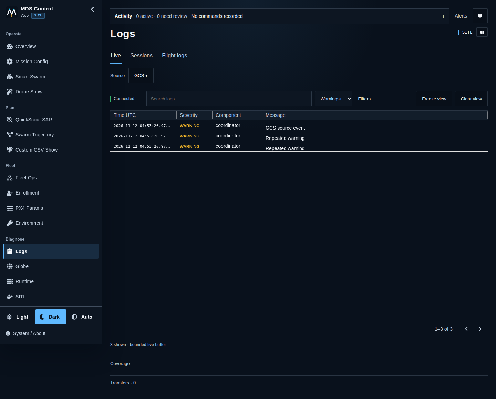
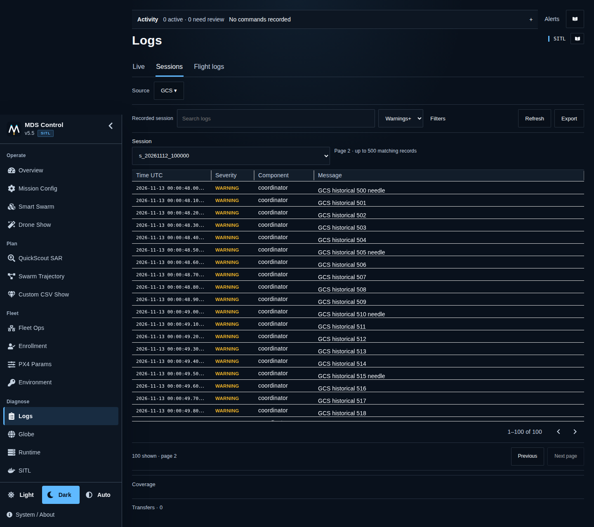
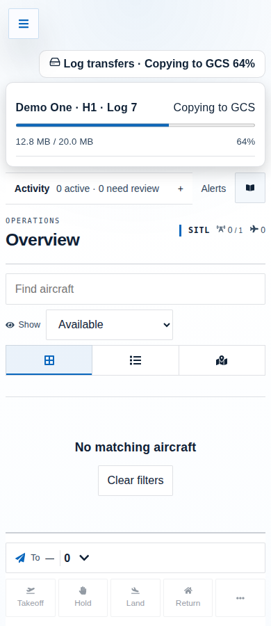
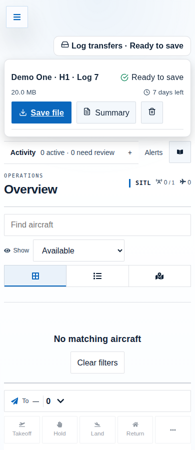

# Logs: operator workflow

Open **Logs** in the sidebar. Start with the tab matching your task; GCS is the
initial source. The screenshots use synthetic aircraft.

| Task | Tab | Next action |
|---|---|---|
| Understand a current message | Live | Select a record |
| Review/export recorded MDS events | Sessions | Choose session → Export |
| Retrieve a PX4 recorder file | Flight logs | Choose aircraft → Get log |

## 1. Watch current events

**Warnings+** is the initial severity. Search immediately; use **Filters** for
component/time window. Select a message for full details. **Freeze view** freezes
the display only; missions and logging continue. **Follow latest** resumes it.
Connection and coverage labels describe this log stream, not aircraft readiness.

## 2. Review a recorded session

Choose **Source**, then **Sessions** and a session. Search and filters apply to
the recording before paging. Use **Next page** for more records. Time bounds are
explicitly UTC: **After** excludes its exact instant; **Through** includes it.
An expired/changed session view needs **Refresh**, not a different aircraft.

## 3. Export evidence

**Export** reviews the exact source and sessions. **Whole selected sessions**
ignores current filters; **Current filters** exports all matching records, not
just the current page. Select JSONL or ZIP; multiple sessions use ZIP. A skipped
record count means coverage is incomplete. Narrow an oversized export.

## 4. Get a flight log

Open **Flight logs**, choose a connected, disarmed aircraft, and select **Get
log** beside the recording. The file time is the recorder's metadata time.
MDS starts an aircraft-to-GCS transfer and opens **Log transfers**.

Once MDS shows **Reading from aircraft**, **Queued**, or **Copying to GCS**,
you can switch pages or close the tab. Reopen MDS in the same browser and
login session, then open **Log transfers**. Keep the aircraft connected until
you see **Ready to save**. If the queue is full, keep the tab open until
the transfer is queued. If MDS shows **Reconnecting**, it checks the
existing request. If the aircraft read fails or the transfer expires, check
the connection and select **Retry**.

## 5. Save, summarize, or remove a GCS copy

| Control | What it does |
|---|---|
| **Save file** | Downloads the verified GCS copy to this device. The aircraft can be offline. The same action appears beside the log if its flight inventory is open. |
| **Summary** | Reads the GCS copy and displays derived PX4 measurements. If you choose Summary first, MDS gets the log and opens the summary when ready. |
| Trash icon | Confirm **Remove GCS copy** to free GCS space immediately. Your device's saved files and the aircraft's original remain available. |

Check your browser's **Downloads** list to see when the save finishes or to
resume an interrupted save. **Save started** means the browser received the
request. Save important recordings before removing the GCS copy or before its
countdown ends.

The GCS holds a temporary copy, typically until 30 minutes after retrieval
started. MDS shows the time left and frees the space automatically. Its default
limits are 512 MiB per file and 1 GiB total. An expired or removed copy must be
retrieved again. Changing browser, switching accounts, or signing out requires
a new transfer. If the GCS restarts during a transfer, return to **Log transfers**
to recover the same request. Completed GCS copies survive a normal service restart.

Summary shows measured values and flags incomplete coverage. A summary error
leaves the verified file available. **Open file** sends a local `.ulg` to your
GCS's temporary parser. Viewer accounts can request an onboard summary, and
operator or admin accounts can retrieve and save raw files.

## Unavailable aircraft and maintenance

- With no aircraft selected/connected, GCS history and **Open file** remain useful.
  An unavailable inventory means unknown, not zero files.
- Stale data remains last observed; it never grants write/erase authority.
  Retry the selected source rather than changing identity implicitly.
- **Remove copy** deletes the verified GCS copy. Recorder originals stay on the aircraft.
  **Maintenance → Erase onboard logs** is a separate admin-only action with an
  exact-aircraft confirmation. It cannot be undone here; verify empty inventory.
- Raw downloads/erase are operator maintenance, not optional assistant/MCP tools.

For installation, API limits, security policy and diagnostics see the
[logging system guide](logging-system.md).
