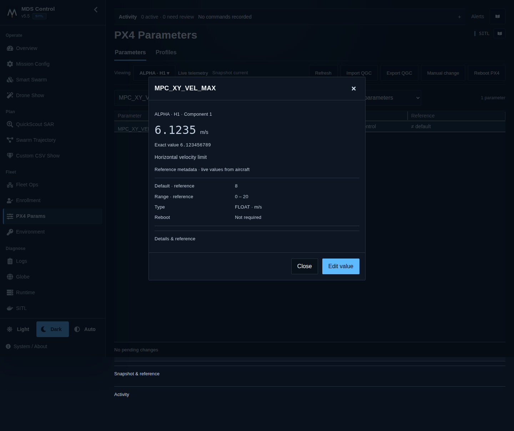
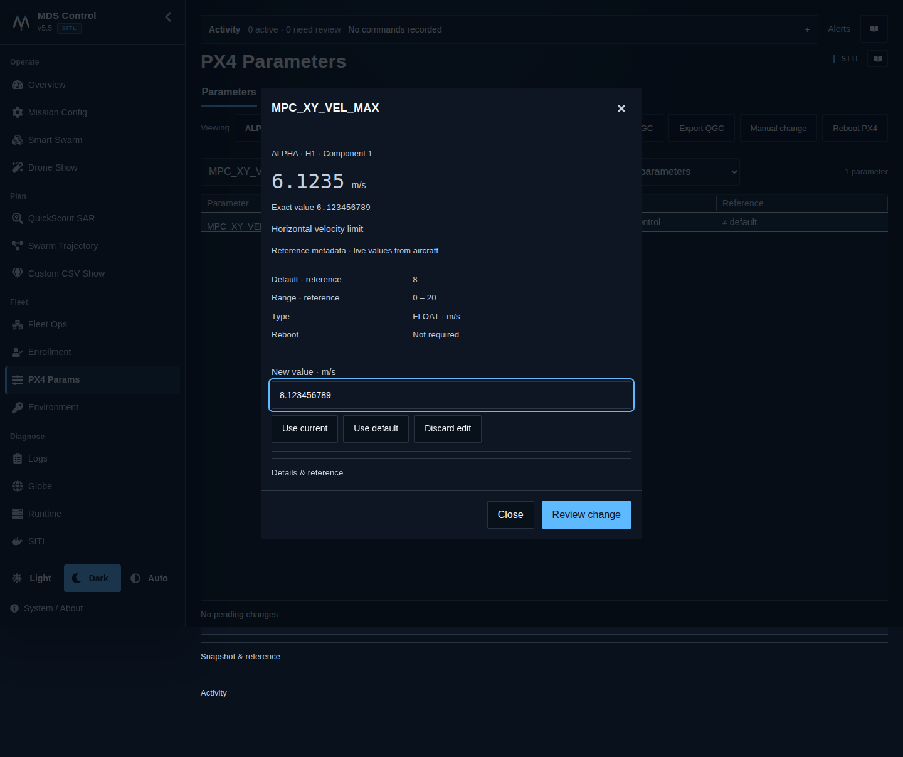
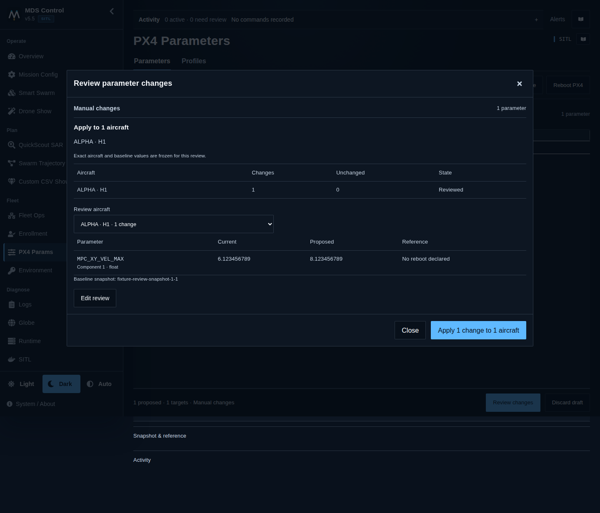
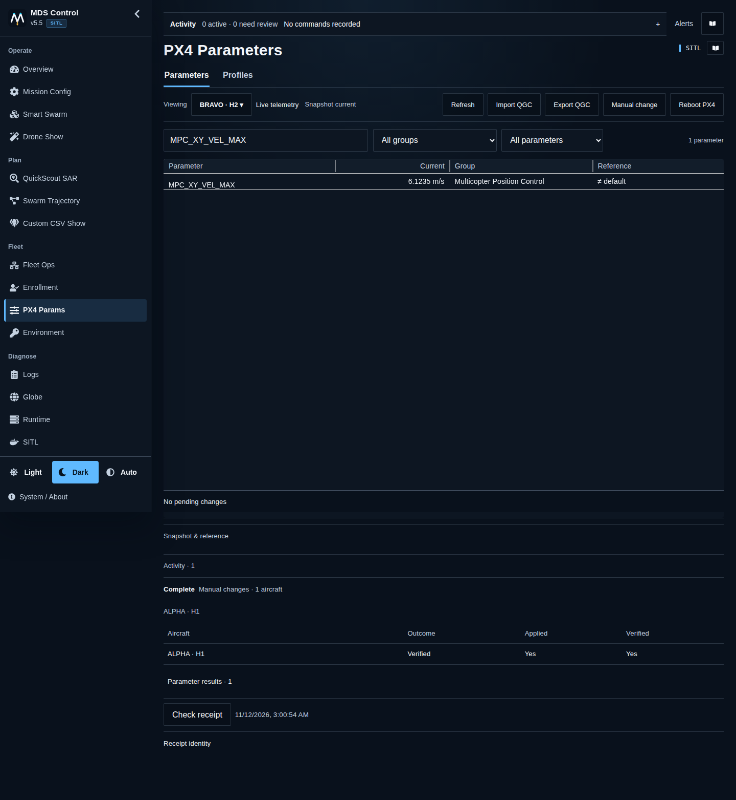
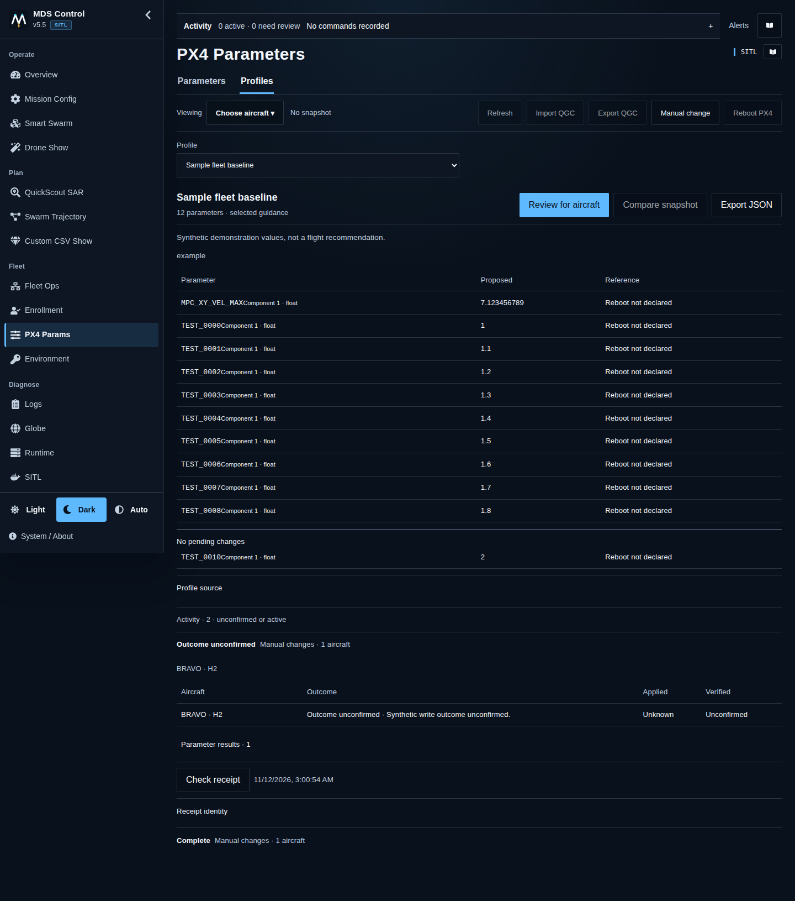

# PX4 Parameters: operator workflow

Open **PX4 Parameters** for inspection and deliberate aircraft maintenance.
This workspace does not tune or reboot an aircraft merely by opening it.

## 1. Inspect

Choose the aircraft, press **Refresh**, then search by parameter name or group.
Check the callsign/hardware ID and snapshot age. Select a row to inspect its
value, units and available reference information. Opening another aircraft does
not change the targets of an existing draft.

## 2. Prepare

Choose **Edit value**, enter the exact value and select **Review change**.
**Use current**, **Use default** and reference choices only populate the draft.
Defaults/ranges from reference material are not proof they match this firmware.

## 3. Review and apply

Check **Apply targets**, then **Prepare review**. A single-aircraft edit starts
with that aircraft; profiles require an explicit target choice. Review each
aircraft's actual current → proposed differences, including any blocked targets.
Changing selection requires a new review. No unavailable aircraft is silently
dropped, and a reconnect never adds a new target.

Select **Apply** once. The receipt identity is saved before dispatch. Native
execution checks the configured live-disarm requirement and expected current
values before each write. A conflicting value requires a refreshed review.

## 4. Read the result

Open **Activity** for each aircraft's result:

| Result | Meaning / next action |
|---|---|
| Verified | The targeted readback matches the requested wire value. |
| Written · unverified | A write was acknowledged, but matching readback is missing. Inspect current values before another decision. |
| Readback mismatch | PX4 returned a different value. Inspect it; do not treat the change as verified. |
| Rejected / Not attempted | Read the target's reason, resolve it and prepare again. |
| Outcome unconfirmed | Use **Check receipt**, including after reloading. Do not repeat Apply to find out what happened. |

Fleet changes are not atomic. A restore is another explicit reviewed change,
not guaranteed rollback. Snapshot refresh failure does not erase known write
evidence. PX4 reboot, if required, is separate and guarded by native state checks.

## Profiles, files and smaller screens

**Profiles** selects a repository-managed baseline. **Import QGC** parses a
`.params` file and reports skipped lines. Both enter the same review; neither
writes automatically. **Export** reads the currently inspected snapshot.
On tablet/phone, grouped rows and the same review dialog preserve these steps.

[Full-size combined guide](../assets/px4-parameters/operator-walkthrough.png).
Illustrations use synthetic aircraft and example values, not flight tuning.
See [PX4 Parameters](../px4-parameters.md) for contracts, storage and validation.
