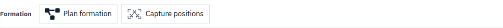
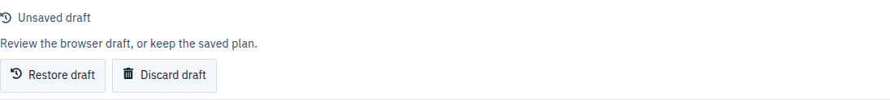
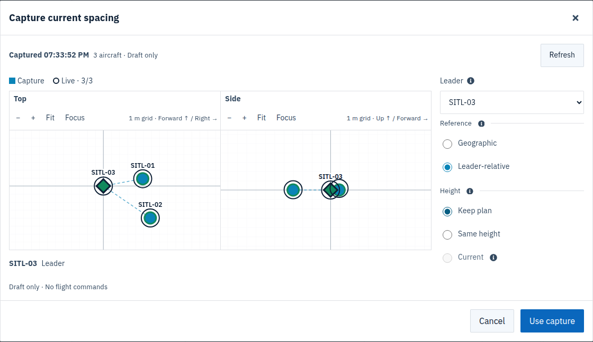
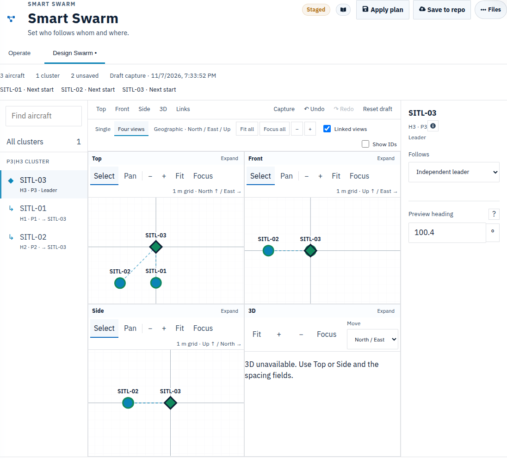
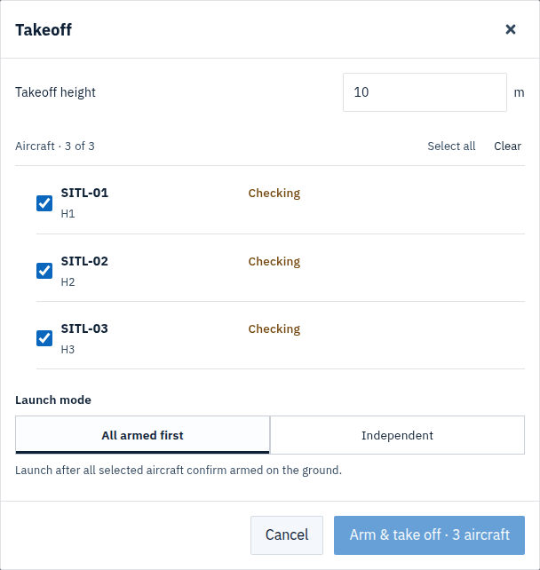
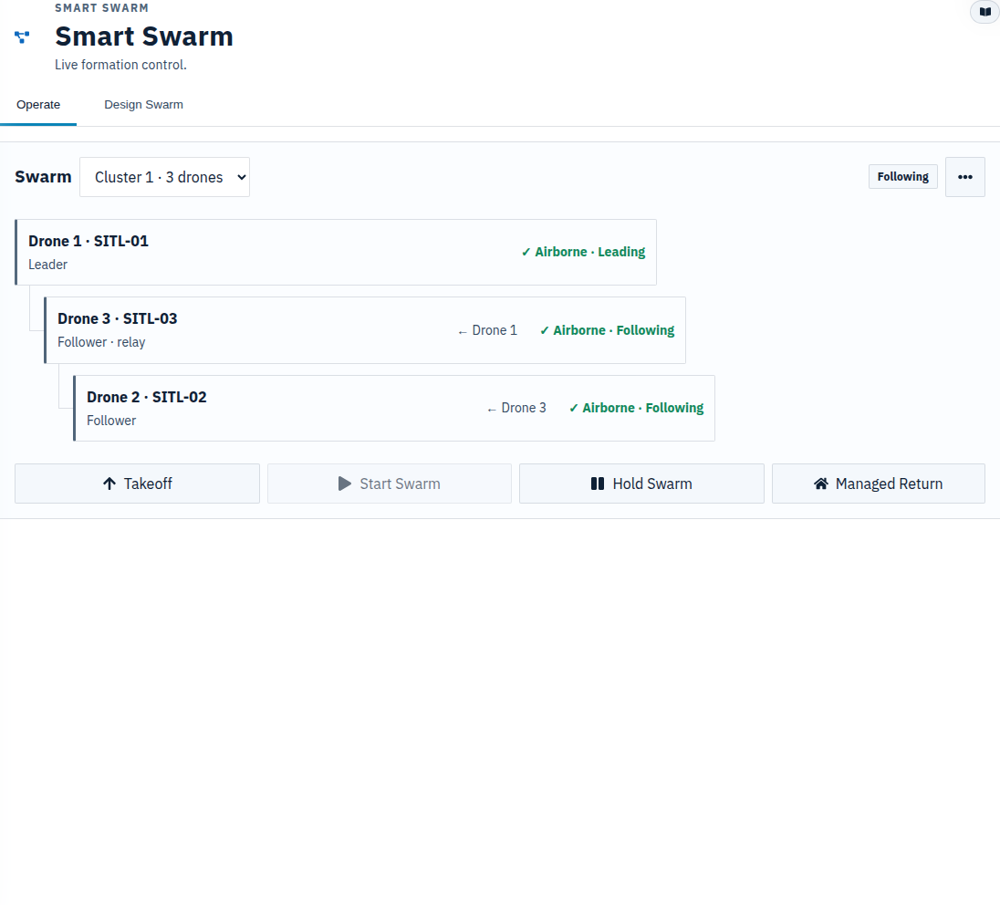
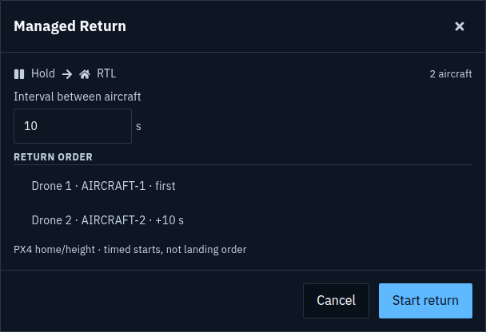

# Smart Swarm operator workflow

Use Smart Swarm to fly one leader with followers, either at planned spacing or
at spacing captured from their current positions. **Design** prepares the
formation; **Operate** controls the aircraft. Opening a page or capturing spacing
never arms or starts a mission.

## Choose how the formation turns

| Reference | What happens when the leader turns its nose |
|---|---|
| **Geographic** | North/East spacing stays fixed geographically. Technical name: NED. |
| **Leader-relative** | Forward/Right spacing rotates with the followed aircraft's heading. Technical name: Body. |

Leader-relative follows heading, not direction of travel. Moving sideways without turning
the nose does not rotate the formation. In both references, **Above** is positive
up; the formation does not tilt with the aircraft's pitch or roll. Followers
also turn their own noses toward the followed aircraft's heading.

## Prepare a planned formation

1. Open **Smart Swarm → Design** and select the intended cluster. The **Formation**
   strip provides **Plan formation** (layout symbol) and **Capture positions**
   (aircraft/crosshair symbol). Planning starts from the saved layout or your
   existing draft; it does not reset your work.
2. Check the leader and each **Follows** relationship. Aircraft labels identify
   physical hardware; changing mission slots does not change these relationships.
3. Select **Geographic** or **Leader-relative**, then edit spacing using the fields
   or drag the aircraft in the linked views. Leader-relative values are Forward,
   Right and Above.
4. Review Top, Front, Side and 3D. **Links** shows relationships, not distances.
   Preview heading changes the drawing only; it does not command yaw.
   If the device cannot display 3D, use the linked 2D views and spacing fields.
   In editable 3D, select a follower and drag its Up arrow to edit Above; all
   directions are available by default. Move-plane restrictions are optional.
5. Choose **Apply plan**. Use **Save to repo** when the formation should also be
   published for fleet startup synchronization.

**Apply plan** persists on this GCS until replaced. It is not a temporary flight
session. Repository publication and effective aircraft adoption are reported
separately; neither means that aircraft have reached their target positions.

**Plan formation** opens the editable workspace. **Capture positions** previews
measurements and adds them to that same draft only after **Use capture**. Switching
setup workflows does not discard edits. These are setup modes, not flight-control
modes; Takeoff and Start Swarm remain separate.

**Revert** is a separate restore-arrow action beside **Undo / Redo**. It replaces
the draft with the saved GCS plan after confirmation, and remains undoable. It is
always visible, disabled when there is nothing to revert. It does not pull Git,
start capture, Apply, or change which setup workflow is open.

An older browser draft is optional under the collapsed **Unsaved draft** control.
**Restore draft** opens it for review, with Undo; **Discard draft** keeps the saved
plan. Neither action applies a plan or sends a command. A draft already matching
the applied plan does not raise a recovery notice.

## Capture the spacing already on the field

Use capture while all aircraft in the selected cluster are stationary on the
ground, or settled in flight with Smart Swarm stopped. It is not moving-flight
capture. Leave room for independent aircraft operation; the following procedure
does not control cable tension or a shared suspended load.

1. Place the aircraft, or establish a stable hover using the normal pilot controls.
2. In **Design**, select **Capture positions**. With one cluster it opens automatically;
   there is no extra aircraft or cluster selection.
   The same **Capture positions** shortcut is visible directly in Operate.
3. Inspect the **3D** formation. Drag to orbit; right-drag or Shift-drag to pan.
   On touch, one finger orbits, two fingers pan and pinch zooms. Fit restores
   the whole view. **Top / Front / Side** give flat views without changing spacing.
   Solid aircraft show the frozen **Capture**; ghost outlines show **Live**
   aircraft estimates. A star marks the leader. Dashed/dim outlines and **Delayed**
   mean the live feed is not current. Live positions never move the captured draft.
4. Check **Height**: grounded defaults to **Same height**; settled airborne defaults
   to **Current**. Leave the selected choice for the usual workflow. To change
   leader or reference, expand **Adjust formation**; these remain as planned by default.
5. Choose **Use capture**. This changes the draft only.
6. Review the linked plots. **Undo** restores the previous edit; **Refresh** in
   Capture obtains new measurements. Changing leader, frame or height choice in
   the capture dialog recalculates from the same frozen measurements. A failed
   refresh retains the drawing but disables Use until a complete refresh succeeds.
7. Select **Apply plan**, or **Save to repo** to apply and publish.

| Height | Use it when |
|---|---|
| **Same height** (ground default) | All aircraft should follow at the same intended height. |
| **Current** (settled-airborne default) | Preserve the estimated height differences of the captured cluster. |
| **Keep plan** | Retain the saved relative heights. |

**Current** is available only when native samples confirm every member is airborne
and its height was stable during capture. It uses the common PX4 global MSL datum,
never each aircraft's separate height above home or local-down origin. This copies
estimates, not surveyed physical heights. A disabled Current option has an info
control explaining what to resolve. Mixed/uncertain states or unstable airborne
height have no automatic choice: select the intended available Height explicitly.
Once you deliberately select Height, Refresh preserves that choice. Before a
deliberate selection, a new successful capture can update the automatic default.
The scene shows the chosen heights before Use capture; nothing moves until a
separate explicit mission action. Symbols are not physical footprints and the
grid is a reference plane, not terrain. The read-only 3D scene also works without WebGL.

### More than one cluster

Capture keeps the cluster selected in Design or Operate. Its **Formation** selector
appears only when there are multiple formations with followers. From **All clusters**,
choose the intended formation first; capture does not silently choose or combine
independent leaders. Each capture replaces only that cluster's draft spacing.
Capture another cluster if needed, then review and Apply the complete draft;
Undo reverses one capture at a time. Single-aircraft independent leaders have no
relative spacing to capture. Roles, heights and spacing of other clusters stay intact.

Capture records PX4's estimated horizontal spacing, not surveyed physical
spacing. It does not calibrate GNSS, heading, home or altitude. Planned heights
follow the visible Height choice; estimated height differences are copied when
Current is selected, including the automatic settled-airborne selection.
Turning the leader after a Leader-relative capture
rotates its future targets. Review again if positions or heading have changed.

Capture never drops an unavailable member and never silently stops a running
controller. Resolve the named issue and refresh. If following is running, use
**Hold Swarm**, confirm the aircraft have stopped following, then capture.
Applying a captured draft repeats the inactive-state check; a concurrent Start
does not turn a pre-start capture into an unnoticed active update.

## Take off and start following

1. Open **Operate**. Confirm the intended complete cluster and fresh aircraft
   states. Resolve any named PX4 or connectivity blocker.
2. Select **Takeoff**. Review the aircraft selection and altitude. For a group,
   **All armed first** waits for every selected aircraft before releasing takeoff.
   It reduces partial launches; it cannot make a distributed launch atomic.
3. Confirm takeoff and watch every aircraft reach a stable hover. Manual/RC or
   QGC takeoff is supported too; an earlier MDS Takeoff command is not required.
4. Select **Start Swarm**, review the formation and confirm. Wait for follower
   engagement on every member before moving the leader.
5. Begin with gentle translation. For Leader-relative, test a slow heading change separately:
   followers need additional motion to travel around the leader as it turns.

## Pause and resume

Select **Hold Swarm** to request Hold for the complete displayed cluster,
including the leader. Confirm each aircraft reports Held or a confirmed grounded
state; **Hold unconfirmed** requires attention. Hold retains the formation but
does not automatically restart following. Select and confirm **Start Swarm** when
ready to resume. RC takeover remains independent of the networked request.

## Change spacing or roles

| Task | Operator sequence |
|---|---|
| Adjust spacing during an unloaded flight | Edit in Design → review → Apply plan. Following aircraft acquire the new targets smoothly within their limits. |
| Change Geographic to Leader-relative without changing the intended preview shape | Change Reference in Design; review using the correct preview heading before Apply. |
| Choose a new leader before starting | Capture → choose Leader → inspect the resulting Links and spacing → Use capture → Apply plan. |
| Choose a new leader while airborne | Hold the cluster → confirm following stopped → let aircraft settle → capture with the new leader → Apply → explicitly Start Swarm. |
| Reuse the same formation tomorrow | Save to repo; review it again before the next start. |
| Use a different field arrangement | Capture again; do not assume yesterday's spacing matches today's placement. |

Changing leaders preserves existing relay links by reversing the path to the new
leader; it does not silently flatten a complex cluster. Inspect **Links** after
the change. Continuous leader replacement while the formation is moving is not
this workflow. Independent clusters remain independent.

Ordinary deliberate in-flight edits use the existing update/readback workflow.
The capture workflow is more specific: its Apply requires stopped following.
**Applied** means configuration installed, not position reached. Missing aircraft
may not adopt an ordinary update at the same time; do not assume simultaneous motion.

## Return and land

For independent aircraft, choose **Managed Return** on Operate.
Review aircraft order and the interval, then confirm. It requests Hold and submits
native RTL commands one by one. The default interval is **10 seconds between
submissions**, not between landings. Watch each aircraft's result.

Immediate RTL uses each aircraft's own PX4 return behavior. Neither immediate
RTL nor Managed Return guarantees nonintersecting paths; PX4 home and return
altitude still determine the flight. A physically attached net needs a separate
loaded-flight and recovery procedure before use.

For **Immediate RTL** or **Land here**, open **Other actions** and check
**Recovery targets**: Entire cluster or the intended individual aircraft.
Land here descends at the current location; RTL follows PX4's return procedure.

## Resolve a blocked step

| Display | Next action |
|---|---|
| Position or heading unavailable | Check the named aircraft's link/navigation source, then Refresh. Capture never substitutes zero heading or raw GPS for a missing estimator position. |
| Aircraft moving or turning | Let the aircraft settle, then Refresh. |
| Following or another action active | Finish or explicitly stop that action; confirm the state before retrying. |
| Plan changed | Keep the draft, review the newer GCS plan, then retry; do not overwrite another operator's work blindly. |
| Plan applied, repo save failed | The GCS plan is already saved. Resolve Git access and retry repository publication. |
| Aircraft offline | Use All on Overview to inspect configured offline aircraft. Current flight states are unavailable, not proof of disarm or landing. |
| Start still finishing takeoff | Wait for the native takeoff transition to finish, then review Start again. |

For detailed configuration, recovery and limits, see the
[Smart Swarm guide](../features/smart-swarm.md). For takeoff behavior, see
[Coordinated Takeoff](coordinated-takeoff.md).
