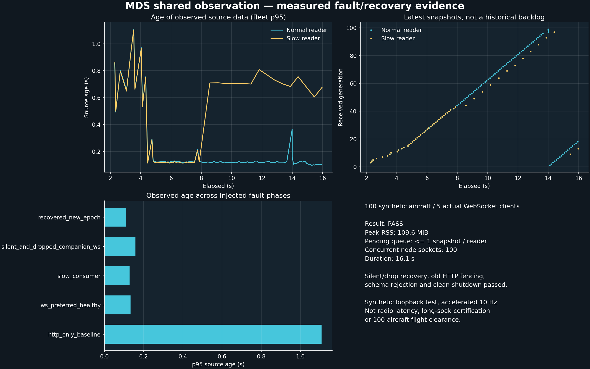

# Communications modernization validation

The communications candidate replaces duplicate fleet readers with shared,
bounded state delivery and independent HTTP fallback. Control gains, native
launch admission, pilot override, stale-leader recovery policy and reviewed
command recipients remain unchanged.

Runtime source under validation: `a6447b8c27ea34246c8255b85844f64f57caa81a`.
Builds and tests run on the designated remote Linux validation host. Real
aircraft remain powered off; hardware installation and flight approval are
separate from this source candidate.

## Implemented behavior

| Domain | Current behavior |
| --- | --- |
| Dashboard | One authenticated, runtime-scoped owner for each canonical fleet resource. Overview, Globe, QuickScout, capture previews and shared Logs/Parameters rosters reuse it. Shell alerts continue after leaving Overview. |
| GCS acquisition | One owner per configured aircraft. Valid identity-matched WS state suppresses normal HTTP reads; silent/unsupported/broken WS retains independent, bounded HTTP acquisition while probes recover. |
| State publication | A generation is encoded once per domain and reused for subscribers. Each subscriber retains at most one pending full snapshot, with connection, byte and send-time bounds. |
| Compatibility | Existing HTTP routes and legacy WS envelopes remain available. Opt-in GCS protocol v1 adds stream epoch, sequence and publication metadata. Snapshot gaps require no replay. |
| Follower motion | A direct companion-to-leader lane, independent of the dashboard and GCS telemetry stream. Only accepted advancing motion renews useful-data liveness; target generations fence old responses. |
| Native identity | A classified FC heartbeat binds the MAVLink source. Same-system sensor components remain supported; hardware ID is not assumed to equal MAVLink system ID. This is source isolation, not cryptographic authentication. |
| Authorization | Existing deployment settings apply. Browser Origin and read authority are checked, with periodic credential revalidation. Authenticated browser state is cleared on context changes. |

Commands retain their durable HTTP submission/lookup and native execution path.
Logs, ULogs, parameters, formation installation and capture authority remain
separate services, not messages in a lossy telemetry queue. Independent companion
heartbeats remain useful when FC data is unavailable. No high-rate WAN debug
mirror is added.

## Defect found by native validation

The native communicator produced `hw_id` and FC availability/age evidence, but
the typed general-state response omitted those fields. The stricter WS ingress
could not promote that unidentified stream, although legacy HTTP still worked.
The response model now preserves these fields on both transports. Missing native
sample time remains `timestamp: 0`; API publication time cannot make an
uninitialized aircraft appear fresh. Regression coverage checks available,
unavailable and unknown states plus missing/nonfinite source times.

## Automated checks

Test groups overlap; the counts below must not be added as a unique-test total.

| Evidence | Result |
| --- | --- |
| Frontend observations, workspaces, command/auth regressions | 458 tests passed across 44 suites |
| Final node/GCS transport, identity, API, auth and contract regressions | 310 tests passed |
| Additional mission boundary and node regressions | 128 tests passed |
| Additional GCS observation/formation regressions | 84 tests passed |
| Command journal, submission and validation tooling | 122 tests passed |
| Documentation/index/tool-candidate checks | 25 tests passed |
| Served-build responsive fixtures | 24 cases passed: 1/3/100 aircraft, 390/768/900/1440 px, dark/light, zero command writes |
| Served-build stream lifecycle fixtures | 4 cases passed: desktop/phone, dark/light, route sharing, silent WS fallback/recovery, one active fleet socket, zero command writes |

The browser stream tests intercept API/WS traffic; they prove browser ownership
and behavior, not aircraft or radio performance. Initial effective-runtime
resolution intentionally resets the protected context; ordinary route changes
within that context do not reconnect its fleet stream.

## Real socket capacity and fault evidence

The disposable loopback harness uses the production aircraft acquisition owner
and GCS publisher, with actual HTTP/WS peers. It runs an accelerated 10 Hz
synthetic workload under a 512 MiB process address-space cap.

| Aircraft and clients | Elapsed | Peak RSS | Pending snapshots per subscriber |
| --- | --- | --- | --- |
| 100 aircraft, 5 clients | 16.08 s | 109.6 MiB | At most 1 |
| 200 aircraft, 5 clients | 33.94 s | 121.9 MiB | At most 1 |

Both runs passed simultaneous companion streams, pooled HTTP fallback, late HTTP
fencing, silent/dropped WS recovery, future-schema rejection, producer-epoch
reset and clean shutdown. Slow readers skip obsolete generations; separate unit
tests prove blocked sends terminate within their deadline.



The graph shows observed source age, not one-way radio latency. Payload byte
counts exclude transport framing. These short loopback runs establish bounded
behavior at the supervisory target, not long-soak, cellular bandwidth or
100-aircraft formation-flight clearance.

Reproduce on a validation host:

```bash
python tools/validate_communications_runtime.py \
  --output-dir /path/to/evidence --aircraft 100 --clients 5

MDS_OVERVIEW_URL=http://127.0.0.1:3038 \
MDS_OVERVIEW_OUTPUT=/path/to/browser-evidence \
node tools/validate_observation_browser.cjs
```

The browser fixture blocks writes and intercepts observations. Neither command
connects to or controls a real aircraft.

## Native SITL acceptance

Two fresh resource-limited native SITL nodes passed both state publishers,
multiple consumers, supervisory WS/HTTP handover and motion fallback through a
loopback fault proxy. The proxy does not change host routing or the management
VPN and sends no flight commands.

Five additional WS viewers observed the live three-node lab GCS during a show.
All received valid identity-matched v1 snapshots with advancing sequences and
one common stream epoch; HTTP exposed that same epoch.

Three-aircraft mission regression passed Smart Swarm, integrated leader/formation
overrides, general actions, Swarm Trajectory and QuickScout. Fresh three-aircraft
Drone Show regression also passed global-auto, global-manual, scheduled-local,
custom CSV and single-aircraft landing override.

The final two-aircraft rehearsal passed in-flight offset and Geographic/Body
changes, a 4.5-second leader outage with protective Hold and subsequent Offboard
rejoin, unchanged saved roles, Apply while held without reactivation, Land and
configuration restore. No stale-data threshold was relaxed for the test.

These runs use an existing validated Python/SDK/PX4 base with source startup sync.
They prove that source/environment tuple, not a new baked image. The release
adds documentation and a read-only browser validation tool to the runtime commit
identified above; the flight/runtime code must match that tested commit.

## Release scope and remaining work

Accepted source scope covers the small-fleet native SITL scenarios above and
the measured supervisory stress cases. Source/SITL acceptance does not verify
the software installed on real aircraft. Downstream integration must preserve
fleet identities, formation, gains, deployment profiles and credentials. Update
the server first, then verify grounded native nodes on the same code before an
operator-controlled flight.

A clean downloadable image rebuild/package is deferred where the full existing
builder cannot retain safe disk headroom. The previous archive remains available;
it must not be described as containing this candidate. No `docker commit` release
or silently mutable pinned-image claim substitutes for that rebuild.

Later measurement work includes cellular delay/jitter/bandwidth profiles,
long-soak behavior and concurrent bulk-transfer budgets. Field/aircraft deltas,
compression, broker adoption, cross-tab ownership and durable command push
cursors remain optional follow-up work. Current commands continue using their
authoritative journal and lookup; telemetry snapshots never replay intent.

Signed browser-session logout still follows the existing stateless-session
model; this phase does not add a server-side session-revocation database.
Simurgh/MCP remains optional and outside the flight loop.
